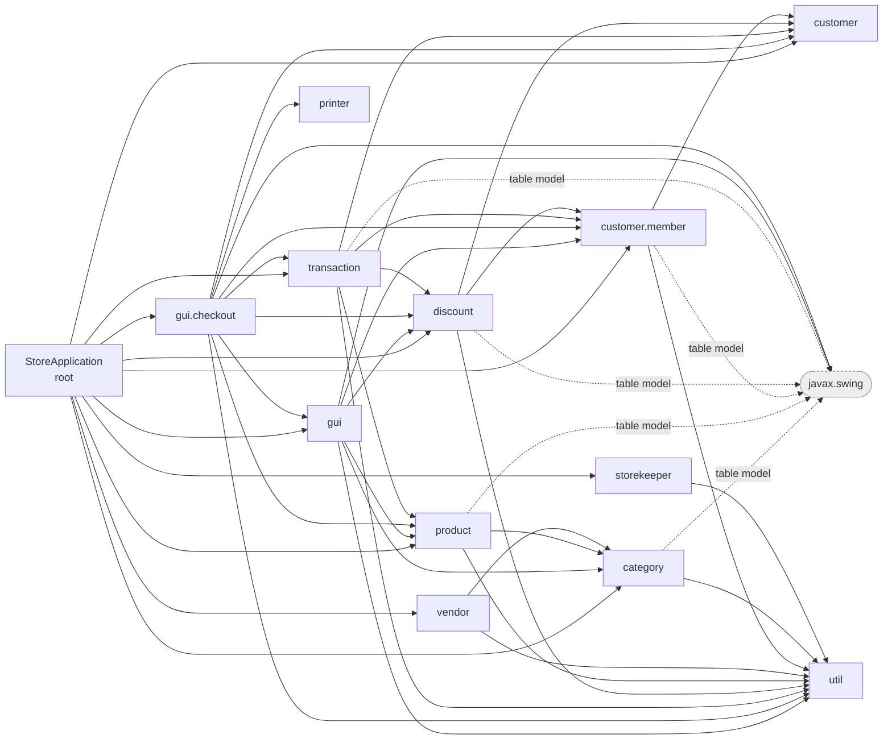
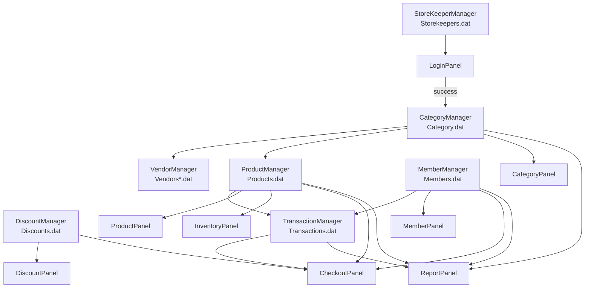
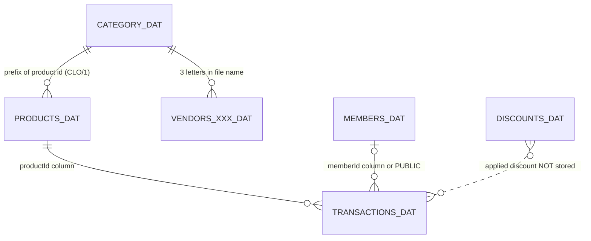

# Phase 1: Inventory Analysis

**Owner:** Member A
**Legacy system:** University Souvenir Store POS (`yangzai/unit1-ca`, branch `master`, last commit `87bee5f`, 4 Apr 2016)
**Analysed on:** 25 Nov 2026

---

## 1.1 Purpose of this phase

This phase lists every asset in the legacy repository: source, tests, data, configuration, build scripts, tools and documentation. For each asset it records:

* **Status:** whether the legacy system actually uses it at runtime or build time.
* **Reuse decision:** what happens to it in the reengineered system.

It also maps the dependencies between assets. Later phases (reverse engineering, restructuring, forward engineering) trace their changes back to the IDs in this inventory (`SRC-xx`, `DAT-xx`, ...).

### Classification scheme

| Status | Meaning |
|---|---|
| **Active** | Executed or loaded when the legacy application runs, or used by its build/test process |
| **Obsolete** | Present in the repository but never used (dead code, unused tooling, IDE leftovers) |

| Reuse decision | Meaning |
|---|---|
| **Reusable (logic)** | Business behaviour is correct and will be re-implemented in the new system; code is not copied verbatim |
| **Reusable (data)** | Content will be migrated into the relational database |
| **Reusable (spec)** | Used as a behavioural specification (e.g. tests whose assertions become regression tests) |
| **Rework** | Needed, but must be redesigned because of smells/defects found |
| **Discard** | Not carried forward |

### 1.1.1 Method and tools

The inventory was produced by static analysis of the source and data files and by dynamic analysis (compiling and running the legacy code). Every number in this document is regenerated by one script, `analysis/inventory/inventory.sh`; its saved output is `analysis/inventory/output/inventory-report.txt`.

| Tool | Used for | Result in this document |
| --- | --- | --- |
| `find`, `ls` | Listing every file in the repository | Asset tables 2.3–2.6 |
| Python line counter | Lines of code per file (handles 22 files without a final newline and 11 with Windows line endings) | 3,883 lines, 3,159 non-blank |
| `grep` | References between classes (obsolete check), `import` lines, `TODO`, `printStackTrace`, commented-out code, Swing imports | Status column; metrics 2.2 |
| `jdeps` (JDK 17 dependency analyser) | Package dependency graph from the compiled classes | Verifies the package dependency graph (1.5.1) |
| `javac` + JUnit 4.12 | Compiling the legacy code and running its tests | 45 of 45 tests pass |
| Probe program (`analysis/legacy-bug-probe`) | Running legacy classes to confirm defects | P1–P8 (Section 4) |
| `git` | History of the original repository | 289 commits, 11 author names, 38 branches |
| `file`, `xxd` | Data-file format, encoding, trailing newlines | Data table 2.5 |
| Manual reading from `main()` | Confirming what is reached at runtime; reuse decisions | Status and Reuse columns |

**Obsolete check.** The script counts, for each class, how many other files reference it. `AdhesiveLabelPrinter` is the only class with 0 references. `VendorManager` has 1 reference, but that is only its creation in `StoreApplication`; the variable is never used again, so it is obsolete in practice.

---

## 1.2 Repository summary (measured)

| Metric | Value |
|---|---|
| Language / platform | Java 8 (Swing desktop GUI), no build tool (Eclipse + IntelliJ project files) |
| Production source files | 40 `.java` files, 3,883 lines (3,159 non-blank) |
| Test source files | 16 `.java` files (15 JUnit 4 test classes + 1 helper), 1,183 lines, **45 test methods** |
| Packages | 13 (`root`, `category`, `customer`, `customer.member`, `discount`, `gui`, `gui.checkout`, `printer`, `product`, `storekeeper`, `transaction`, `util`, `vendor`) |
| Data files | 11 CSV-style `.dat` files in `data-sample/` |
| Third-party runtime libraries | **None** (only the JDK) |
| Test libraries | JUnit 4.12, Hamcrest-core 1.3 |
| `TODO` comments | 12 |
| `printStackTrace()` calls (swallowed errors) | 16 |
| Commented-out code lines | ≈ 62 |
| Git history | 289 commits, 3 Mar 2016 → 4 Apr 2016, 6 developers (11 different author identities), 38 remote branches |
| Legacy test result (re-run by us on JDK 17) | **45 / 45 pass**, compiled with `javac -encoding UTF-8` |

---

## 1.3 Asset inventory

### 1.3.1 Production source code (`src/sg/edu/nus/iss/se24_2ft/unit1/ca/…`)

| ID | File | LOC | Responsibility | Status | Reuse decision | Notes |
|---|---|---|---|---|---|---|
| SRC-01 | `StoreApplication.java` | 115 | Entry point; creates every manager and panel and wires them together | Active | Rework | Hard-coded file paths; acts as composition root and configuration |
| SRC-02 | `util/Util.java` | 51 | Date/number parsing, dollar formatting, CSV split | Active | Rework | Shared static `SimpleDateFormat` (not thread-safe); naive CSV split |
| SRC-03 | `category/Category.java` | 31 | Category entity (3-letter code, name) | Active | Reusable (logic) | Two-step id initialisation (`requestedId` → `setId()`) |
| SRC-04 | `category/CategoryManager.java` | 128 | Load/save `Category.dat`, add category, Swing table model | Active | Rework | Mixes persistence, validation and UI model |
| SRC-05 | `customer/Customer.java` | 8 | Interface for member/public customer | Active | Reusable (logic) | |
| SRC-06 | `customer/PublicCustomer.java` | 40 | Singleton "PUBLIC" customer | Active | Reusable (logic) | 20 lines of commented-out code |
| SRC-07 | `customer/member/Member.java` | 108 | Member entity, loyalty point arithmetic | Active | Rework | `-1` sentinel for "never purchased"; 40 lines of commented-out code |
| SRC-08 | `customer/member/MemberManager.java` | 163 | Load/save `Members.dat`, add member, credit/debit points, table model | Active | Rework | |
| SRC-09 | `discount/Discount.java` | 70 | Discount entity and "is active today" rule | Active | Reusable (logic) | Uses `null`/`-1` to mean "ALWAYS" |
| SRC-10 | `discount/DiscountManager.java` | 155 | Load/save `Discounts.dat`, add discount, best-discount selection, table model | Active | Rework | Hard-codes the codes `MEMBER_FIRST` / `MEMBER_SUBSEQ` |
| SRC-11 | `product/Product.java` | 75 | Product entity, understock and restock rules | Active | Reusable (logic) | Price as `double` |
| SRC-12 | `product/ProductManager.java` | 247 | Load/save `Products.dat`, add product, ID generation, stock deduction, purchase order, 2 table models | Active | Rework | Largest manager; duplicated table-model code |
| SRC-13 | `storekeeper/StoreKeeper.java` | 28 | Storekeeper credentials | Active | Rework | Plain-text password |
| SRC-14 | `storekeeper/StoreKeeperManager.java` | 56 | Load `Storekeepers.dat`, login check | Active | Rework | |
| SRC-15 | `transaction/Transaction.java` | 237 | Sale header + line items, totals, discount, redemption, payment, table model | Active | Rework | Domain class depends on Swing |
| SRC-16 | `transaction/TransactionItem.java` | 51 | Sale line (product, quantity) | Active | Reusable (logic) | `toString()` doubles as file format |
| SRC-17 | `transaction/TransactionManager.java` | 221 | Load/save `Transactions.dat`, finalise sale (points, stock), table model | Active | Rework | Contains the member-ID corruption defect (see Phase 3) |
| SRC-18 | `vendor/Vendor.java` | 29 | Vendor entity (name, description, categories) | Active (loaded) | Reusable (logic) | |
| SRC-19 | `vendor/VendorManager.java` | 77 | Loads `Vendors<CAT>.dat` files | **Obsolete in practice** | Reusable (data) | Instantiated in `StoreApplication` but **never queried**; no UI uses vendors |
| SRC-20 | `printer/Printer.java` | 20 | Abstract printer, prints to console | Active | Rework | `id`/`count` and `getTag()` unused |
| SRC-21 | `printer/ReceiptPrinter.java` | 11 | Receipt printer (console) | Active | Rework | Only its static `print` is used |
| SRC-22 | `printer/AdhesiveLabelPrinter.java` | 11 | Label printer | **Obsolete** | Discard | Never referenced |
| SRC-23 | `gui/MainFrame.java` | 20 | Main window with left-side tabs | Active | Rework | |
| SRC-24 | `gui/FeaturePanel.java` | 24 | Abstract base for tab panels | Active | Discard | 3 of 4 constructors unused |
| SRC-25 | `gui/LoginPanel.java` | 113 | Modal login dialog | Active | Rework | |
| SRC-26 | `gui/CategoryPanel.java` | 97 | Category list + add form | Active | Rework | |
| SRC-27 | `gui/MemberPanel.java` | 104 | Member list + add form | Active | Rework | |
| SRC-28 | `gui/ProductPanel.java` | 207 | Product list + add form | Active | Rework | Invalid numbers silently become 0 |
| SRC-29 | `gui/InventoryPanel.java` | 79 | Understock list + purchase order | Active | Rework | |
| SRC-30 | `gui/DiscountPanel.java` | 231 | Discount list + add form | Active | Rework | Result of add (true/false) ignored |
| SRC-31 | `gui/ReportPanel.java` | 179 | 4 report tabs, transaction date filter | Active | Rework | |
| SRC-32 | `gui/checkout/CheckoutPanel.java` | 270 | Checkout screen | Active | Rework | |
| SRC-33 | `gui/checkout/ConfirmPaymentDialog.java` | 287 | Payment, redemption, change | Active | Rework | Largest class; duplicates business rules |
| SRC-34 | `gui/checkout/ReceiptDialog.java` | 281 | Receipt display + console print | Active | Rework | |
| SRC-35…40 | `gui/*PanelListener.java`, `gui/checkout/CheckoutPanelListener.java` (6 files) | 7–12 each | Observer interfaces between panels and managers | Active | Reusable (logic) | The Observer idea is kept; the interfaces are replaced |
| SRC-41 | `src/META-INF/MANIFEST.MF` | 2 | JAR manifest (`Main-Class`) | Active | Discard | |

### 1.3.2 Test code (`test/…`)

| ID | File | Tests | What it checks | Status | Reuse decision |
|---|---|---|---|---|---|
| TST-01 | `CategoryTest` | 4 | Category construction/trim | Active | Reusable (spec) |
| TST-02 | `CategoryManagerTest` | 3 | Load, add, duplicate/invalid IDs | Active | Reusable (spec) |
| TST-03 | `DiscountTest` | 2 | Discount fields / active window | Active | Reusable (spec) |
| TST-04 | `DiscountManagerTest` | 4 | Load, add, max discount | Active | Reusable (spec) |
| TST-05 | `MemberTest` | 4 | Member fields, loyalty arithmetic | Active | Reusable (spec) |
| TST-06 | `MemberManagerTest` | 3 | Load, add, duplicate IDs | Active | Reusable (spec) |
| TST-07 | `ProductTest` | 6 | Product fields, understock, restock | Active | Reusable (spec) |
| TST-08 | `ProductManagerTest` | 4 | Load, add, ID generation, barcode uniqueness | Active | Reusable (spec) |
| TST-09 | `StoreKeeperTest` | 3 | Storekeeper fields | Active | Reusable (spec) |
| TST-10 | `StoreKeeperManagerTest` | 2 | Login success/failure | Active | Reusable (spec) |
| TST-11 | `TransactionTest` | 1 | Transaction totals | Active | Reusable (spec) |
| TST-12 | `TransactionItemTest` | 3 | Line item | Active | Reusable (spec) |
| TST-13 | `TransactionManagerTest` | 1 | Load + add transaction | Active | Reusable (spec) |
| TST-14 | `VendorTest` | 4 | Vendor fields | Active | Reusable (spec) |
| TST-15 | `VendorManagerTest` | 1 | Vendor files load | Active | Reusable (spec) |
| TST-16 | `util/TestUtil.java` | – | Writes fixture `.dat` files into `test/` and deletes them | Active | Rework |

**Test gaps:**
* There are no GUI or checkout end-to-end tests, and checkout logic has only one test.
* No test reloads data after a sale. That is why the member-ID corruption defect (Phase 3, P1) went unnoticed.
* The tests write fixture files into the source folder `test/`.

### 1.3.3 Data files (`data-sample/`, copied to `data/` at runtime)

| ID | File | Rows | Format (columns) | Status | Reuse decision |
|---|---|---|---|---|---|
| DAT-01 | `Category.dat` | 5 | `code,name` | Active | Reusable (data) |
| DAT-02 | `Products.dat` | 10 | `CAT/n,name,description,qty,price,barcode,threshold,orderQty` | Active | Reusable (data) |
| DAT-03 | `Members.dat` | 11 | `name,memberId,loyaltyPoints` (`-1` = never purchased) | Active | Reusable (data) |
| DAT-04 | `Discounts.dat` | 5 | `code,description,startDate\|ALWAYS,periodDays\|ALWAYS,percent,M\|A` | Active | Reusable (data) |
| DAT-05 | `Transactions.dat` | 4 | `txId,productId,memberId\|PUBLIC,qty,date` (one row per line item) | Active | Reusable (data) – after repair |
| DAT-06 | `Storekeepers.dat` | 2 | `name,password` (plain text) | Active | Reusable (data) – passwords must be hashed |
| DAT-07…11 | `VendorsCLO.dat`, `VendorsDIA.dat`, `VendorsMUG.dat`, `VendorsSNA.dat`, `VendorsSTA.dat` | 4 each | `vendorName,description`; category is encoded **in the file name** | Obsolete in practice (loaded, never used) | Reusable (data) |

**Observations on the data files:**
* No file ends with a newline.
* Files use UTF-8 curly apostrophes (`’`) in `Discounts.dat` and all vendor files.
* The 5 vendor files contain **identical** rows, so the vendor–category relationship is repeated in every file instead of stored once.
* All three promotional discounts are dated 2014, so today only `MEMBER_FIRST`/`MEMBER_SUBSEQ` can ever apply.

### 1.3.4 Configuration, build and tooling

| ID | Asset | Purpose | Status | Reuse decision | Notes |
|---|---|---|---|---|---|
| CFG-01 | `.classpath`, `.project` | Eclipse project | Active (IDE only) | Discard | Puts `data/` on the classpath |
| CFG-02 | `unit1-ca.iml`, `.idea/*` (7 files) | IntelliJ project, JAR artifact "jar-with-data" | Active (IDE only) | Discard | JUnit jar path refers to the IntelliJ install directory |
| CFG-03 | `unit1-ca.eml`, `unit1-ca.userlibraries` | Eclipse-in-IntelliJ leftovers | **Obsolete** | Discard | Empty/unused |
| CFG-04 | `.gitignore` | Ignores `/data/`, submission outputs | Active | Rework | |
| BLD-01 | `submission/compile.bat` | Compiles with `javac` on Windows | Active (Windows only) | Discard | Typos `CompileOpiton`, `classses` in CLASSPATH |
| BLD-02 | `submission/run.bat`, `submission/setenv.bat` | Runs the app; sets `JAVA_HOME` | Active (Windows only) | Discard | Hard-codes `C:\Program Files\Java\jdk1.8.0_77` and **replaces** `PATH` |
| BLD-03 | `submission.bat`, `submission.sh` | Builds the course submission ZIP | **Obsolete** | Discard | `submission.sh` has typo `sunmission/data` (cleanup never runs) |
| TOOL-01 | `tools/7z.exe`, `tools/7z.dll` | Bundled 7-Zip binary for packaging | **Obsolete** | Discard | Third-party binary committed to the repository |

### 1.3.5 Documentation

| ID | Asset | Content | Status | Reuse decision |
|---|---|---|---|---|
| DOC-01 | `README.md` | Git workflow for the original team, "copy data-sample to data" | Active (partly accurate) | Rework (rewritten in Phase 2) |
| DOC-02 | `submission/docs/report.doc` | Short report: team list, UML domain diagram (image), assumptions on loyalty points, purchase orders, printers, barcodes, vendors | Active (accurate, incomplete) | Reusable (spec): assumptions become documented business rules |
| DOC-03 | Javadoc / comments | Sparse; author headers only | Active (sparse) | Discard |

> There is **no** requirements specification, architecture description, data dictionary or user guide in the repository. Phase 2 recreates them.

---

## 1.4 External dependencies

| Dependency | Version | Used for | Where | Status | Reuse decision |
|---|---|---|---|---|---|
| Java SE (JDK) | 1.8 (project setting); runs on 17 | Language/runtime | Everywhere | Active | Discard (replaced by Python 3.12) |
| `javax.swing`, `java.awt` | JDK | GUI **and** table models inside managers | `gui/*`, and 6 non-GUI classes (see below) | Active | Discard (replaced by Django views and templates) |
| `java.nio.file.Files` | JDK | Reading/writing `.dat` files | 7 manager classes | Active | Discard (replaced by the Django ORM and a relational database) |
| `java.util.Date`, `Calendar`, `SimpleDateFormat` | JDK (legacy date API) | Dates, discount periods | `Util`, `Discount`, `Transaction`, GUI | Active | Discard (replaced by Python `datetime`) |
| JUnit | 4.12 | Unit tests | `test/` | Active | Discard (replaced by the Django test runner; assertions reused as specification) |
| Hamcrest-core | 1.3 | JUnit dependency | `test/` | Active | Discard |
| 7-Zip | bundled `.exe` | Packaging submission | `tools/` | Obsolete | Discard |
| Windows `cmd` | – | Compile/run scripts | `submission/*.bat` | Active (Windows only) | Discard (replaced by `requirements.txt` and `manage.py`) |

**Coupling to Swing outside the GUI package (6 classes):** `CategoryManager`, `MemberManager`, `DiscountManager`, `ProductManager`, `TransactionManager`, `Transaction`. These all create `javax.swing.table.AbstractTableModel` objects, so the business layer cannot be used without Swing.

---

## 1.5 Dependency maps

### 1.5.1 Package dependency graph (from `import` statements)

**Tool verification with jdeps.** Running `jdeps -verbose:package` on the compiled legacy classes found 39 package-to-package dependencies. The graph above contains exactly these 39 arrows: none missing and none extra (full tool output: `analysis/inventory/output/jdeps-packages.txt`). The report version of this diagram draws 24 of them and leaves out the links to the helper packages `util` and `customer` for readability. `jdeps` also confirms the layer violation: exactly 5 business packages (`category`, `customer.member`, `discount`, `product`, `transaction`) depend on `javax.swing.table`.

**Reading the graph:**
* `gui.checkout` depends directly on **8** other packages, and in particular on `TransactionManager` constants. It is the most coupled module.
* `transaction` is the most depended-on business package and the most coupled one. It reaches into `product`, `customer.member` and `discount`.
* The dotted arrows show the **layer violation**: business/data classes depend on the GUI toolkit.
* No package cycles exist at the package level. The logical layers are still tangled because each "Manager" combines three roles (data access, business rules and UI model).

### 1.5.2 Runtime object wiring and load order (`StoreApplication.main`)

**Load-order constraint:** `Category` must load before `Products` and `Vendors`, and `Products` and `Members` must load before `Transactions`. A row whose referenced category or product is missing is **silently skipped**. This ordering becomes foreign-key constraints in the relational schema (Phase 5).

### 1.5.3 Data-file dependency map (implicit foreign keys)

---

## 1.6 Inventory conclusions (input to later phases)

| # | Finding | Evidence | Feeds |
|---|---|---|---|
| INV-1 | Every "Manager" class mixes file I/O, validation, business rules and a Swing table model | SRC-04/08/10/12/17 | Phase 3 smells; Phase 4 layering |
| INV-2 | Persistence is 11 hand-parsed CSV files with no escaping, no schema and no transactions | DAT-01…11, `Util.splitCsv` | Phase 5 data restructuring |
| INV-3 | Several assets are dead: `AdhesiveLabelPrinter`, `Printer` id/tag, `VendorManager` (loaded but never used), 3 `FeaturePanel` constructors, ≈62 lines of commented-out code | SRC-19/20/22/24, SRC-06/07 | Phase 4 (remove dead code) |
| INV-4 | The build and run process works only on Windows with a hard-coded JDK path; there is no dependency management | BLD-01/02, CFG-02 | Forward engineering: use a standard build tool |
| INV-5 | Vendor data is duplicated across 5 files; categories are encoded in file names and product IDs | DAT-07…11, DAT-02 | Phase 5 normalisation |
| INV-6 | Existing tests pass (45/45) but do not cover checkout, persistence round-trips or the GUI | TST-01…16 | Testing strategy / regression suite |
| INV-7 | No real documentation exists apart from a short assumptions report | DOC-01/02 | Phase 2 |
| INV-8 | Sensitive data is stored in plain text | DAT-06 | Risk register R-09 |
