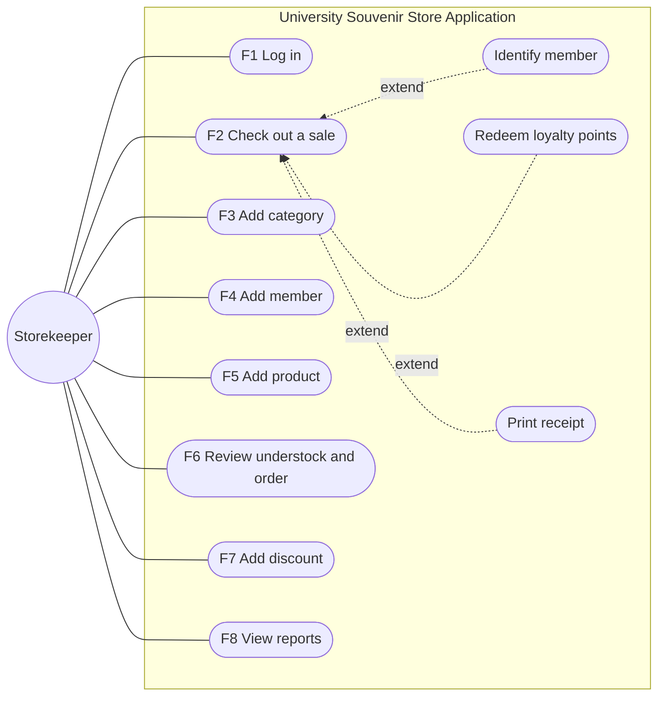
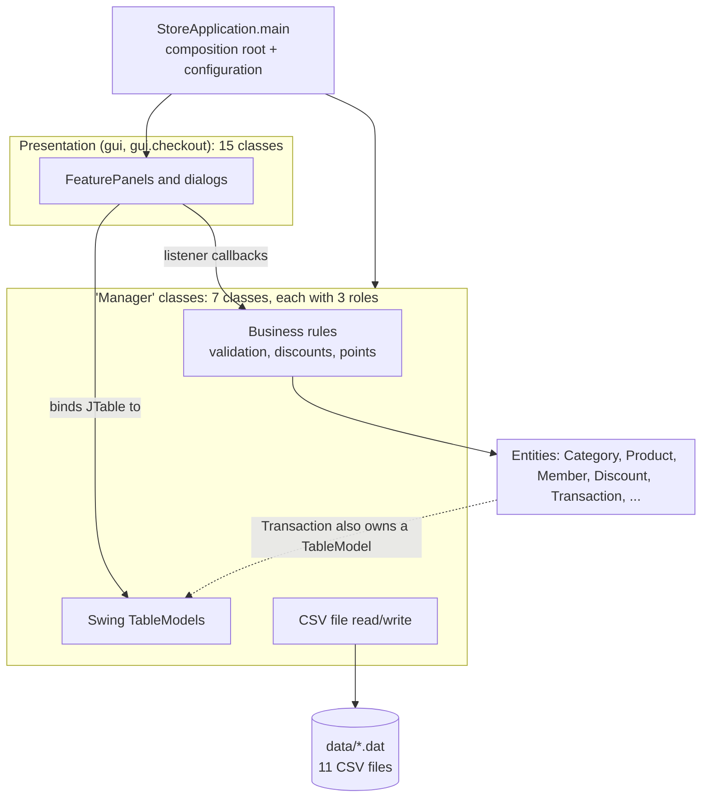
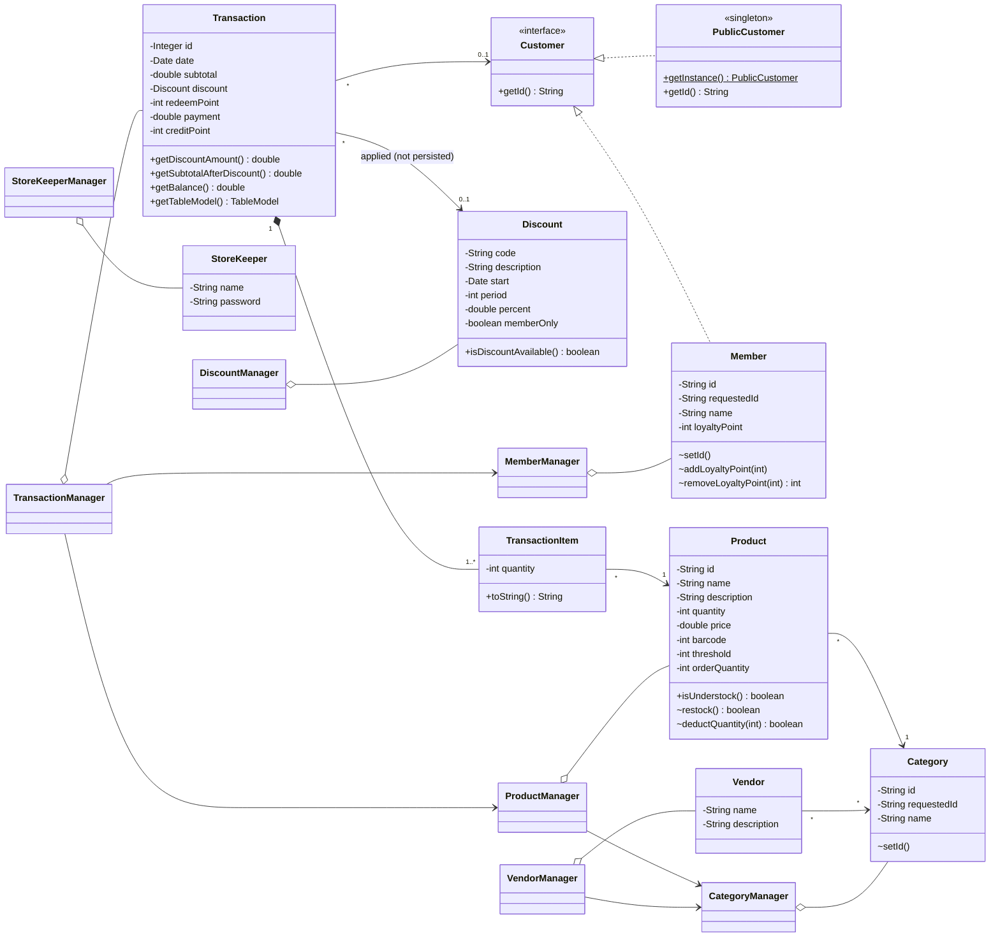
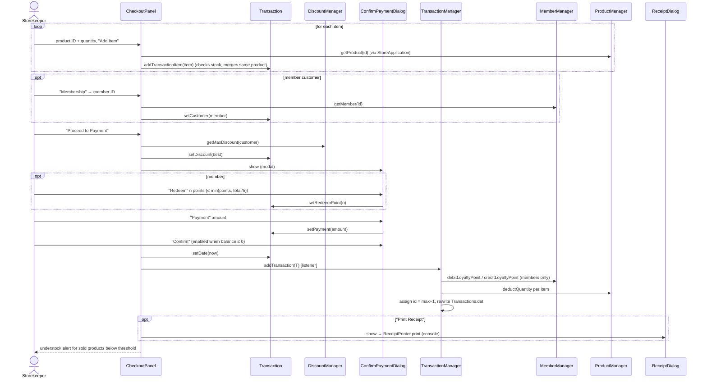

# Phase 2: Document Restructuring (Legacy System Documentation)

**Owner:** Member A
**Documentation set:** A, legacy system (reverse-engineered)

The legacy repository has only a git-workflow README and a 4-page assumptions report (Inventory DOC-01, DOC-02). This document **recreates** the technical documentation from the code as it actually behaves. Every statement was checked against the source (file:line references given), and the behaviours marked "verified" were confirmed by running the code.

---

## 2.1 System overview

| Item | Description |
|---|---|
| Name | University Souvenir Store Application |
| Purpose | Point-of-sale and back-office tool for a small university souvenir shop |
| Users | **Storekeeper** (the only actor who logs in). Customers are either registered **members** (earn/redeem loyalty points) or **public** (anonymous). |
| Deployment | Single-user Java Swing desktop application on one workstation |
| Persistence | 11 comma-separated text files in a `data/` folder relative to the working directory |
| Hardware | Receipt printer and barcode reader are **simulated**: receipts go to the console and a dialog, and IDs are typed by hand (DOC-02) |

### 2.1.1 Functional scope (as implemented)

| ID | Feature | GUI entry point | Back-end class |
|---|---|---|---|
| F1 | Storekeeper login | `LoginPanel` (modal dialog at start-up) | `StoreKeeperManager.login` |
| F2 | Checkout / sale | Tab **Checkout** → `CheckoutPanel`, `ConfirmPaymentDialog`, `ReceiptDialog` | `TransactionManager.addTransaction` |
| F3 | Register product category | Tab **New Category** → `CategoryPanel` | `CategoryManager.addCategory` |
| F4 | Register member | Tab **New Member** → `MemberPanel` | `MemberManager.addMember` |
| F5 | Register product | Tab **New Product** → `ProductPanel` | `ProductManager.addProduct` |
| F6 | Check understock inventory and generate purchase order | Tab **Inventory** → `InventoryPanel` | `ProductManager.generatePurchaseOrder` |
| F7 | Maintain discounts | Tab **Discount** → `DiscountPanel` | `DiscountManager.addDiscount` |
| F8 | Reports: categories, products, transactions (date range), members | Tab **Reports** → `ReportPanel` | table models of 4 managers |

**Not implemented:**
* update or delete of any record (a deliberate decision in DOC-02)
* vendor maintenance or vendor display
* storekeeper management
* returns or refunds
* multi-user operation

### 2.1.2 Use-case diagram

---

## 2.2 Recovered architecture

### 2.2.1 Architectural style

The legacy system calls itself object-oriented. In practice it is a **two-tier, tightly-coupled desktop application**:

**Observed characteristics:**
1. **No service layer.** Business rules are spread across the entities (`Discount.isDiscountAvailable`), managers (`DiscountManager.getMaxDiscount`, `TransactionManager.addTransaction`) and GUI dialogs (`ConfirmPaymentDialog` recomputes the maximum redeemable points).
2. **No data-access layer.** Each manager has its own `load()` and `store()` that parse and write CSV directly, using about 7 copies of the same code.
3. **Presentation leaks into the domain.** Managers and `Transaction` build `javax.swing.table.AbstractTableModel` objects and fire table events.
4. **Configuration in code.** File paths (`"data/Products.dat"`, ...), loyalty rates (`DOLLAR_TO_POINT = 10`, `POINT_TO_DOLLAR = 5`) and discount codes are compile-time constants.

### 2.2.2 Design patterns already present

| Pattern | Where | Comment |
|---|---|---|
| Observer (listener) | `*PanelListener` interfaces; `StoreApplication` registers method references such as `categoryManager::addCategory` | Good idea that decouples panels from managers; kept in the new design |
| Singleton | `PublicCustomer.getInstance()` | Represents the anonymous customer |
| Template Method / abstract hook | `LoginPanel.login(...)`, `CheckoutPanel.getProduct/getMember/getDiscount` are abstract and implemented anonymously in `StoreApplication` | Works as manual dependency injection |
| Lazy initialisation | `getTableModel()` in each manager | Causes a `NullPointerException` when used before the model exists (see 2.6, L-12) |

### 2.2.3 Module (package) inventory

| Package | Classes | Responsibility | Layer it *should* belong to |
|---|---|---|---|
| `(root)` | `StoreApplication` | Start-up, login gate, object creation, wiring, tab registration | Configuration / composition root |
| `category` | `Category`, `CategoryManager` | Category entity; load/save/add; table model | Domain + Service + Repository + UI (mixed) |
| `customer` | `Customer`, `PublicCustomer` | Customer abstraction | Domain |
| `customer.member` | `Member`, `MemberManager` | Member entity; loyalty points; load/save/add | Domain + Service + Repository + UI (mixed) |
| `discount` | `Discount`, `DiscountManager` | Discount entity; active-date rule; best-discount selection | Domain + Service + Repository + UI (mixed) |
| `product` | `Product`, `ProductManager` | Product entity; stock; ID generation; purchase order | Domain + Service + Repository + UI (mixed) |
| `storekeeper` | `StoreKeeper`, `StoreKeeperManager` | Credentials, login | Domain + Service + Repository |
| `transaction` | `Transaction`, `TransactionItem`, `TransactionManager` | Sale, totals, payment, points, stock deduction | Domain + Service + Repository + UI (mixed) |
| `vendor` | `Vendor`, `VendorManager` | Vendors per category (loaded only) | Domain + Repository |
| `printer` | `Printer`, `ReceiptPrinter`, `AdhesiveLabelPrinter` | Console "printing" | Infrastructure |
| `util` | `Util` | Parsing, formatting, CSV split | Cross-cutting |
| `gui` | `MainFrame`, `FeaturePanel`, `LoginPanel`, 6 panels, 5 listener interfaces | Swing screens | Presentation |
| `gui.checkout` | `CheckoutPanel`, `ConfirmPaymentDialog`, `ReceiptDialog`, `CheckoutPanelListener` | Sale screens | Presentation (but contains business rules) |

### 2.2.4 Recovered class diagram (domain and managers)

`~` means package-private. Encoded meanings omitted from the diagram: `Member.loyaltyPoint = -1` means "never purchased"; `Discount.start = null` and `period = -1` mean `ALWAYS`; `Product.id` has the form `CAT/n`; `PublicCustomer.getId()` returns `"PUBLIC"`; `TransactionItem.toString()` produces the CSV row. Each `Manager` also holds a `List`, a `Map` index, a file name and one or two `AbstractTableModel`s. These are omitted for readability.

### 2.2.5 Key interaction: checkout (F2)

---

## 2.3 Data documentation (legacy data dictionary)

All files are UTF-8 text, comma-separated, with **no header row, no quoting and no escaping**. `Util.splitCsv` simply calls `String.split(",", -1)`. On every change the **whole file is rewritten**, sorted by ID (transactions are written in list order). Files are found relative to the process working directory: `data/<name>.dat`.

### `Category.dat`
| # | Field | Type | Rule enforced by code |
|---|---|---|---|
| 1 | code | text | Exactly 3 characters, unique (`CategoryManager.java:39-42, 66-73`) |
| 2 | name | text | Trimmed; not validated |

Example: `CLO,Clothing`

### `Products.dat`
| # | Field | Type | Rule enforced by code |
|---|---|---|---|
| 1 | id | text `CAT/n` | Unique. The prefix must be an existing category. `n` is generated as (max `n` in that category) + 1 (`ProductManager.java:101-103`) |
| 2 | name | text | Not validated |
| 3 | description | text | Not validated |
| 4 | quantity | int | Default 0 when unparsable |
| 5 | price | decimal (`double`) | Default 0 when unparsable |
| 6 | barcode | int | Unique (`ProductManager.java:94`) |
| 7 | threshold | int | Product is "understock" when `quantity ≤ threshold` |
| 8 | orderQuantity | int | Amount added by a purchase order |

Example: `MUG/1,Centenary Mug,A really nice mug this time,525,10.25,9876,25,150`

### `Members.dat`
| # | Field | Type | Rule |
|---|---|---|---|
| 1 | name | text | – |
| 2 | memberId | text | Unique, not blank |
| 3 | loyaltyPoints | int | **`-1` means "has never purchased"** and qualifies for `MEMBER_FIRST` |

Example: `Ang Lee,R64565FG4,-1`

### `Discounts.dat`
| # | Field | Type | Rule |
|---|---|---|---|
| 1 | code | text | Upper-cased, unique |
| 2 | description | text | – |
| 3 | startDate | `yyyy-MM-dd` or `ALWAYS` | `ALWAYS` is stored as `null` |
| 4 | periodDays | int or `ALWAYS` | `ALWAYS` is stored as `-1` |
| 5 | percent | decimal | Written back as `20.0` even if read as `20` |
| 6 | applicableTo | `M` or `A` | `M` = members only, `A` = all customers |

### `Transactions.dat`
| # | Field | Type | Rule |
|---|---|---|---|
| 1 | transactionId | int | Repeated for each line of the same sale; new id = max + 1 |
| 2 | productId | text | Must exist in `Products.dat` |
| 3 | memberId | text or `PUBLIC` | Repeated on every line of the sale |
| 4 | quantity | int | – |
| 5 | date | `yyyy-MM-dd` | Repeated on every line of the sale |

**Not stored:** unit price at time of sale, discount applied, points redeemed or earned, amount paid. A historical receipt therefore **cannot be reproduced** from the data.

### `Storekeepers.dat`
`name,password`, with the password in **plain text**. The name is the lookup key and is case-sensitive.

### `Vendors<CAT>.dat` (5 files)
`vendorName,description`. The category is taken from characters 8–10 of the **file name** (`VendorManager.java:40`), and only files matching `Vendors[A-Z]{3}.dat` are read. A vendor appearing in several files is treated as one vendor serving several categories.

---

## 2.4 Business rules catalogue (recovered)

These rules are what the reengineered system must preserve. Each one will become a regression test.

| ID | Rule | Source |
|---|---|---|
| BR-01 | A storekeeper logs in when the name exists and the password matches exactly. Closing the login dialog exits the program. | `StoreKeeperManager.java:51-55`, `StoreApplication.java:40` |
| BR-02 | A category code must be non-blank, exactly 3 characters and unique. | `CategoryManager.java:66-73` |
| BR-03 | A member ID must be non-blank and unique. A new member starts with loyalty `-1` (no purchase yet). | `MemberManager.java:56-61`, `Member.java:21` |
| BR-04 | A product must belong to an existing category, and its barcode must be unique. Its ID is `<category>/<max+1>`. | `ProductManager.java:88-107` |
| BR-05 | A product is understock when `quantity ≤ threshold`. | `Product.java:49` |
| BR-06 | A purchase order for selected understock products adds `orderQuantity` to stock immediately (the goods are assumed to arrive at once). | `ProductManager.java:155-172`, DOC-02 |
| BR-07 | A discount is active when `start` is `ALWAYS`, or when `start ≤ now ≤ start + period days (23:59:59)`. A period of `ALWAYS` means it is open-ended. Example: start 2014-02-01, period 7 → active until 2014-02-08 23:59:59. | `Discount.java:56-66`, `Util.java:13-21` |
| BR-08 | Only **one** discount applies per sale: the active, eligible discount with the **highest percent**. | `DiscountManager.java:57-75` |
| BR-09 | Member-only (`M`) discounts never apply to public customers. `MEMBER_FIRST` applies only when loyalty = `-1`, and `MEMBER_SUBSEQ` only when loyalty ≠ `-1`. (Verified: new member → `MEMBER_FIRST`, existing member → `MEMBER_SUBSEQ`, public → none.) | `DiscountManager.java:61-70` |
| BR-10 | Adding an item checks the **cumulative** quantity of that product in the sale against stock, and the same product is merged into one line. Quantity is 1–9999. | `Transaction.java:152-179`, `CheckoutPanel.java:177-211` |
| BR-11 | Subtotal = Σ(quantity × unit price). Discount amount = subtotal × percent / 100. Total = subtotal − discount. | `Transaction.java:68-76, 181` |
| BR-12 | Redemption: 1 point = **$5**. The maximum redeemable is min(member points, ⌊total / 5⌋), so points are never turned into change. | `TransactionManager.java:27, 159-164`, `ConfirmPaymentDialog.java:158-161` |
| BR-13 | Earning: ⌊subtotal **before** discount / **10**⌋ points per sale (members only). The member's balance becomes `points − redeemed + earned`, and a first purchase replaces the `-1`. | `TransactionManager.java:26, 170-180`, `Member.java:53-56` |
| BR-14 | Payment must be ≥ 0 with at most 2 decimals. The sale can be confirmed only when payment + redemption value ≥ total. Change = payment + redemption − total. | `ConfirmPaymentDialog.java:206-234`, `TransactionManager.java:167-168` |
| BR-15 | On confirmation, stock is deducted, the sale gets id = max existing id + 1, the date is today, and the sold products that are now understock are listed in an alert. | `TransactionManager.java:182-207`, `CheckoutPanel.java:125-146` |
| BR-16 | Discount entry rules: blank start = `ALWAYS`; blank/invalid period = `ALWAYS`; a fractional period is rejected; invalid percent = 0; the code is upper-cased. | `DiscountPanel.java:190-213`, `Discount.java:22` |
| BR-17 | The transaction report filters by an inclusive start/end date range and defaults to the first and last transaction dates. | `ReportPanel.java:98-117, 173-177` |
| BR-18 | No record can be modified or deleted through the application. | DOC-02 |

---

## 2.5 Configuration and operation

| Topic | Legacy behaviour |
|---|---|
| Install | Clone the repository, then `cp -r data-sample data` (README) |
| Build | IDE (Eclipse/IntelliJ) or `submission/compile.bat` (Windows; JDK 1.8 found through the registry or `setenv.bat`) |
| Run | `java -cp classes sg.edu.nus.iss.se24_2ft.unit1.ca.StoreApplication` from the folder that contains `data/` |
| Default logins | `Stacy` / `Dean56s`, `Johny` / `A12ysd45` (from `Storekeepers.dat`) |
| Configurable settings | None at runtime. Paths, loyalty rates and discount codes require code changes. |
| Logging / errors | `printStackTrace()` to the console (16 places), plus `JOptionPane` messages for validation errors |
| Tests | JUnit 4. Fixture files are written to and deleted from `test/` (needs `test/` as the working directory prefix). 45/45 pass. |

---

## 2.6 Dependencies and limitations

### 2.6.1 Dependencies
See Inventory §1.4 and §1.5. In summary: JDK only (Swing, NIO, legacy `java.util.Date`), JUnit 4.12 for tests, Windows batch scripts and a bundled 7-Zip for packaging.

### 2.6.2 Limitations and weaknesses

Each item was found by reading the code. Items marked **(verified)** were reproduced by running the legacy classes; see `analysis/legacy-bug-probe/`.

| ID | Limitation / weakness | Evidence | Impact |
|---|---|---|---|
| L-01 | **Member history is destroyed after any new sale (verified).** On load, the check is inverted: `memberId.equals("PUBLIC")` looks up a member, and everything else becomes `PUBLIC`. The next save rewrites every earlier member sale as `PUBLIC`. | `TransactionManager.java:78-80`. Probe P1: `1,CLO/1,F42563743156,…` becomes `1,CLO/1,PUBLIC,…` | Permanent data loss; reports by member are wrong |
| L-02 | **Product names containing a comma corrupt the file (verified).** `Mug, Large` reloads as name `Mug`, description `Large`, quantity 0, price 10.0 | `Util.splitCsv`; probe P4 | Silent data corruption |
| L-03 | **One malformed line stops start-up (verified).** `ArrayIndexOutOfBoundsException` escapes the constructor. | All `load()` methods; probe P5 | Application cannot start |
| L-04 | **Lower-case category codes are accepted but cannot be found again (verified).** `addCategory` stores `"bks"`, while `getCategory` upper-cases the lookup. | `CategoryManager.java:54-55, 66-77`; probe P3 | Products can never be added to that category |
| L-05 | **A duplicate discount code is silently ignored (verified).** `addDiscount` returns `false`, and the GUI ignores the result. | `DiscountManager.java:84`, `StoreApplication.java:61`; probe P6 | User thinks the discount was saved |
| L-06 | **Stock deduction can crash (verified)** if the understock table model was never created. | `ProductManager.java:146-150`; probe P2 | `NullPointerException` |
| L-07 | Sales do not store price, discount, redemption or payment | `TransactionItem.toString` | Receipts and revenue cannot be audited |
| L-08 | Money uses `double`: for example (2×21.45 + 3×10.25) × 0.9 = 66.28500000000001 | `Product.price`, `Transaction` | Rounding errors in totals |
| L-09 | Passwords stored and compared in plain text | `Storekeepers.dat`, `StoreKeeper.java` | Security |
| L-10 | No update/delete, no vendor UI, single user, no concurrency control (the whole file is rewritten on each change) | All managers | Functional limits; risk of lost updates |
| L-11 | Business rules duplicated between GUI and back end (redemption cap computed in 3 places; one place compares points with dollars) | `ConfirmPaymentDialog.java:158-184`, `Transaction.java:206-207`, `TransactionManager.java:159-164` | Inconsistent behaviour |
| L-12 | Lazy table models are mandatory: back-end methods assume a GUI exists | `ProductManager.java:149` | The back end cannot run headless or as an API |
| L-13 | Hard-coded paths, rates and discount codes | `StoreApplication.java:31-48`, `TransactionManager.java:26-27`, `DiscountManager.java:64-68` | Every change needs a recompile |
| L-14 | Windows-only build scripts with a hard-coded JDK path; no build tool | BLD-01/02 | Hard to build and deploy |
| L-15 | Errors are swallowed with `printStackTrace` (16 places); there is no logging framework | All managers | Failures go unnoticed |
| L-16 | UI copy-paste defect: for public customers, "Redeem Value" label/field visibility is set on the wrong component | `ConfirmPaymentDialog.java:110, 116-117` | Confusing payment screen |
| L-17 | All 2014 promotions have expired, so only member discounts ever apply today (verified: public best discount = none) | `Discounts.dat`; probe P7 | Expected behaviour, but test expectations must account for the current date |

---

## 2.7 Glossary

| Term | Meaning in this system |
|---|---|
| Storekeeper | Staff user who logs in and operates the POS |
| Member | Registered customer identified by a member ID (e.g. a student card number) |
| Public customer | Anonymous customer, stored as `PUBLIC` |
| Loyalty points | Earned at 1 point per $10 of subtotal and redeemed at $5 per point |
| Threshold | Stock level at or below which a product is understock |
| Order quantity | Quantity added to stock when a purchase order is generated |
| Purchase order | Immediate restock of the selected understock products |
| `ALWAYS` | Marker meaning "no start date" or "no end", depending on the column |
