# POS Reengineering – Member A Report

Inventory Analysis, Document Restructuring, Risk Register and Domain-Model Refactorings

Member A: Malik Nouman Ahmed · 25 November 2026

## 1. Introduction

This report covers Member A's share of the reengineering of the legacy University Souvenir Store POS. It contains the inventory of the legacy system, its restructured documentation, the project risk register and three implemented domain-model refactorings with 44 passing tests.

| Item | Value |
| --- | --- |
| Legacy system | University Souvenir Store application, `github.com/yangzai/unit1-ca`, commit `87bee5f` (4 Apr 2016) |
| Legacy technology | Java 8, Swing desktop GUI, 11 CSV `.dat` files, no build tool, JUnit 4 |
| Target technology | Python 3.12 + Django 5.2 LTS, relational database (SQLite in development, PostgreSQL configurable) |
| Project repository | `github.com/NOMI9797/POS-Reengineering` (private) |
| Member A | Malik Nouman Ahmed |

### 1.1 Scope of Member A

| Process-model phase / activity | Member A deliverable | Section |
| --- | --- | --- |
| 1. Inventory Analysis | Asset inventory, classification, dependency maps | 2 |
| 2. Document Restructuring | Legacy system documentation (documentation set A) | 3 |
| Legacy documentation set A | Dependencies, limitations, verified defects, code and data smells | 4 |
| Risk analysis (throughout) | Risk register R-01 to R-17 | 5 |
| 4. Code Restructuring | Refactorings A1, A2, A3 (domain model) | 6 |
| Testing (throughout) | Legacy test baseline, defect probes, 44 new tests | 7 |

Phases 3 (reverse engineering), 5 (data restructuring) and 6 (forward engineering) belong to Members B and C. Section 8 lists what this part hands to them.

### 1.2 Method

Every statement about the legacy system was checked against its source code, and file:line references are given. Behaviours marked **verified** were reproduced by compiling the legacy code on JDK 17 and running it. The 45 legacy JUnit tests were run first (all pass). A probe program then exercised the defects the tests do not cover (Section 4).

## 2. Phase 1: Inventory Analysis

The legacy repository holds 41 source assets, 16 test files, 11 data files and 18 configuration, build, tool and documentation files. Of these, 5 are dead or unused and every business "Manager" needs rework. The IDs below (`SRC-`, `TST-`, `DAT-`, `CFG-`, `BLD-`, `TOOL-`, `DOC-`) are used by later phases to trace each change back to an asset.

### Method and tools

The inventory was produced by static analysis of the source and data files and by dynamic analysis (compiling and running the legacy code). Every number in this section is regenerated by one script, `analysis/inventory/inventory.sh`; its saved output is `analysis/inventory/output/inventory-report.txt`.

| Tool | Used for | Result in this section |
| --- | --- | --- |
| `find`, `ls` | Listing every file in the repository | Asset tables 2.3–2.6 |
| Python line counter | Lines of code per file (handles 22 files without a final newline and 11 with Windows line endings) | 3,883 lines, 3,159 non-blank |
| `grep` | References between classes (obsolete check), `import` lines, `TODO`, `printStackTrace`, commented-out code, Swing imports | Status column; metrics 2.2 |
| `jdeps` (JDK 17 dependency analyser) | Package dependency graph from the compiled classes | Verifies the package dependency diagram (2.8) |
| SonarQube Community Build 26.11 (run locally in Docker) with SonarScanner | Code size, complexity, duplication and smell indicators in a web dashboard | SonarQube views 1–10 (2.2, 4.3) |
| `javac` + JUnit 4.12 | Compiling the legacy code and running its tests | 45 of 45 tests pass |
| Probe program (`analysis/legacy-bug-probe`) | Running legacy classes to confirm defects | P1–P8 (Section 4) |
| `git` | History of the original repository | 289 commits, 11 author names, 38 branches |
| `file`, `xxd` | Data-file format, encoding, trailing newlines | Data table 2.5 |
| Manual reading from `main()` | Confirming what is reached at runtime; reuse decisions | Status and Reuse columns |

**Obsolete check.** The script counts, for each class, how many other files reference it. `AdhesiveLabelPrinter` is the only class with 0 references. `VendorManager` has 1 reference, but that is only its creation in `StoreApplication`; the variable is never used again, so it is obsolete in practice.

**Why SonarQube and the terminal.** SonarQube was used for the part of the inventory it covers well: code size, complexity, duplication and smell indicators, shown in a web dashboard. It does not cover the rest of the inventory: it ignores data files, configuration and documentation, its free edition lists no libraries and draws no package dependency map, it flags only unused private code (so it cannot find the unused public class `AdhesiveLabelPrinter`), and it neither runs the tests nor executes the legacy code. Those activities were therefore done in the terminal (tool evidence, steps 1–8).

| Inventory activity | Done in | Evidence |
| --- | --- | --- |
| Code size: files, classes, lines | SonarQube and terminal | Views 2–4; steps 1–2 |
| Complexity and duplication | SonarQube | Views 5–7 |
| Smell indicators (TODO, printStackTrace) | SonarQube and terminal | Views 8–10; step 4 |
| Data, configuration and documentation assets | Terminal | Step 1 |
| Obsolete classes | Terminal | Step 3 |
| Package dependencies and the GUI layer violation | Terminal (`jdeps`) | Steps 5–6 |
| Running the legacy tests | Terminal (JUnit) | Step 7 |
| Confirming defects by running the code | Terminal (probe) | Step 8 |

SonarQube analysed the unmodified legacy code with a quality profile named "POS Inventory": the default "Sonar way" rules plus maintainability rules such as TODO comments, commented-out code and method length, which the default profile of this version leaves out.

**SonarQube view 1: starting the server and running the scan.**

`start-sonarqube.sh` starts SonarQube in Docker and waits until the dashboard at http://localhost:9000 is ready. `run-sonar-scan.sh` then compiles the unmodified legacy code and runs SonarScanner, which analyses it and uploads the results; the run ends with ANALYSIS SUCCESSFUL.

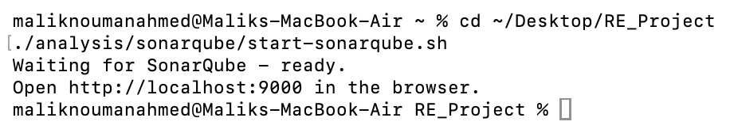

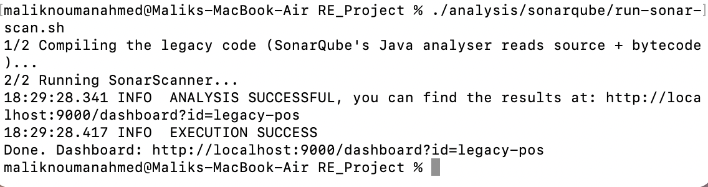

### 2.1 Classification scheme

| Status | Meaning |
| --- | --- |
| Active | Executed or loaded when the application runs, or used by its build/test process |
| Obsolete | Present but never used (dead code, unused tooling, IDE leftovers) |

| Reuse decision | Meaning |
| --- | --- |
| Reusable (logic) | Behaviour is correct and is re-implemented in the new system |
| Reusable (data) | Content is migrated into the relational database |
| Reusable (spec) | Used as a behavioural specification (e.g. test assertions become regression tests) |
| Rework | Needed, but redesigned because of smells or defects |
| Discard | Not carried forward |

### 2.2 Repository metrics (measured)

| Metric | Value |
| --- | --- |
| Production source | 40 `.java` files, 3,883 lines (3,159 non-blank), 13 packages |
| Tests | 15 JUnit 4 classes + 1 helper, 1,183 lines, 45 test methods |
| Data | 11 CSV `.dat` files |
| Third-party runtime libraries | None (JDK only) |
| `TODO` comments | 12 |
| Swallowed errors (`printStackTrace()`) | 16 |
| Commented-out code | about 62 lines |
| Git history | 289 commits, 3 Mar to 4 Apr 2016, 6 developers, 38 remote branches |
| Legacy test result (re-run on JDK 17) | 45 of 45 pass |

**Tool evidence, step 1: identifying all assets with find.**

The `find` and `ls` commands walk the legacy repository and count every Java source file, test file, data file and package. This is the starting point of the inventory: it proves the asset totals used in the tables below.

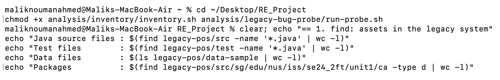

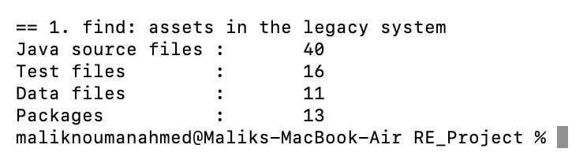

**Tool evidence, step 2: measuring the size of the code with a line counter.**

A short Python program reads every source file and counts its lines, including lines that `wc -l` would miss (22 files lack a final newline). It also lists the largest classes, which are the first candidates for restructuring.

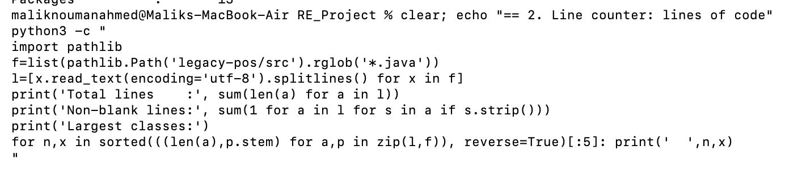

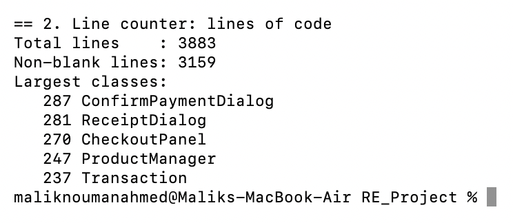

**SonarQube view 2: summary of the legacy project.**

The Overall Code summary shows 2.8k lines of code, 16 security, 1 reliability and 92 maintainability issues, and 2.1% duplication. Coverage is 0.0% because no coverage report was supplied.

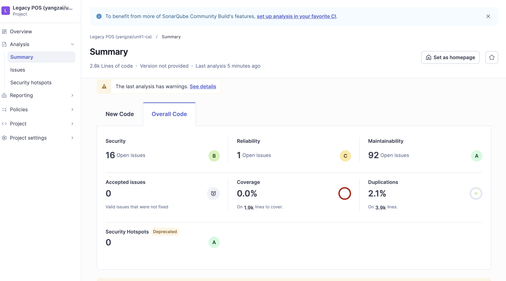

**SonarQube view 3: identifying the code assets.**

The Code view shows the two analysed source trees: `src` with 2,848 lines of code, and `test`.

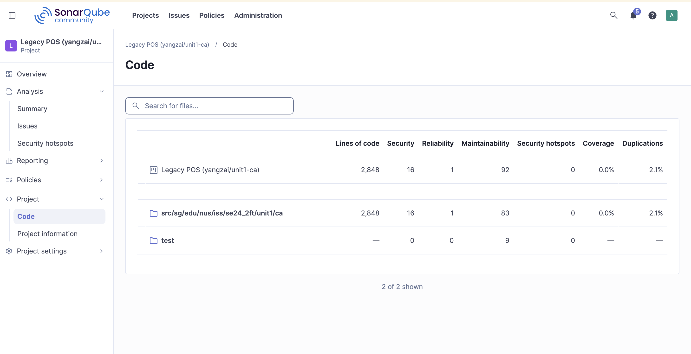

**SonarQube view 4: size measures.**

SonarQube counts 40 files, 40 classes, 219 functions and 3,901 lines (2,848 lines of code, 245 comment lines). The 3,901 lines equal the inventory's 3,883 plus the empty line SonarQube counts after the final newline in the 18 files that have one.

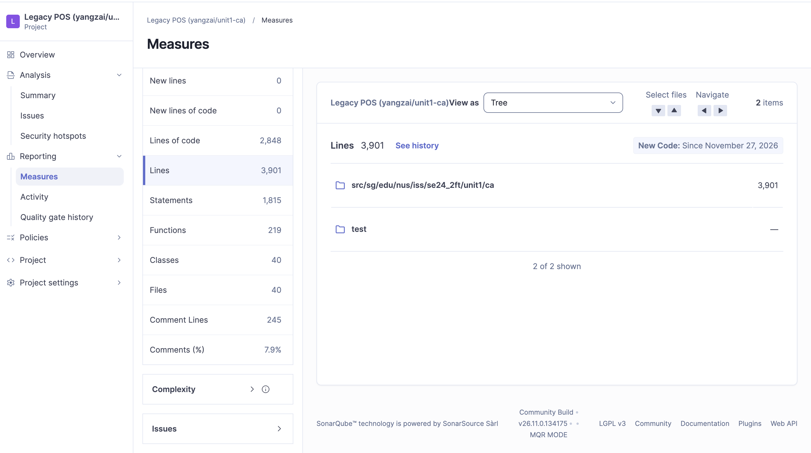

### 2.3 Production source code

| ID | File | LOC | Responsibility | Status | Reuse |
| --- | --- | --- | --- | --- | --- |
| SRC-01 | `StoreApplication` | 115 | Entry point; creates and wires every manager and panel | Active | Rework |
| SRC-02 | `util/Util` | 51 | Date/number parsing, dollar format, CSV split | Active | Rework |
| SRC-03 | `category/Category` | 31 | Category entity | Active | Reusable (logic) |
| SRC-04 | `category/CategoryManager` | 128 | Load/save, add, Swing table model | Active | Rework |
| SRC-05 | `customer/Customer` | 8 | Customer interface | Active | Reusable (logic) |
| SRC-06 | `customer/PublicCustomer` | 40 | Singleton public customer | Active | Reusable (logic) |
| SRC-07 | `customer/member/Member` | 108 | Member entity, loyalty arithmetic (`-1` sentinel) | Active | Rework |
| SRC-08 | `customer/member/MemberManager` | 163 | Load/save, add, credit/debit points, table model | Active | Rework |
| SRC-09 | `discount/Discount` | 70 | Discount entity, "active today" rule | Active | Reusable (logic) |
| SRC-10 | `discount/DiscountManager` | 155 | Load/save, add, best-discount selection | Active | Rework |
| SRC-11 | `product/Product` | 75 | Product entity, understock/restock | Active | Reusable (logic) |
| SRC-12 | `product/ProductManager` | 247 | Load/save, ID generation, stock, purchase order, 2 table models | Active | Rework |
| SRC-13 | `storekeeper/StoreKeeper` | 28 | Credentials (plain text) | Active | Rework |
| SRC-14 | `storekeeper/StoreKeeperManager` | 56 | Login check | Active | Rework |
| SRC-15 | `transaction/Transaction` | 237 | Sale totals, discount, redemption, payment, table model | Active | Rework |
| SRC-16 | `transaction/TransactionItem` | 51 | Sale line; `toString()` is the file format | Active | Reusable (logic) |
| SRC-17 | `transaction/TransactionManager` | 221 | Load/save, finalise sale | Active | Rework |
| SRC-18 | `vendor/Vendor` | 29 | Vendor entity | Active (loaded) | Reusable (logic) |
| SRC-19 | `vendor/VendorManager` | 77 | Loads vendor files; never queried | Obsolete in practice | Reusable (data) |
| SRC-20 | `printer/Printer` | 20 | Console printing; `id`, `getTag()` unused | Active | Rework |
| SRC-21 | `printer/ReceiptPrinter` | 11 | Receipt printer (console) | Active | Rework |
| SRC-22 | `printer/AdhesiveLabelPrinter` | 11 | Never referenced | Obsolete | Discard |
| SRC-23 | `gui/MainFrame` | 20 | Main window with tabs | Active | Rework |
| SRC-24 | `gui/FeaturePanel` | 24 | Base panel; 3 of 4 constructors unused | Active | Discard |
| SRC-25 | `gui/LoginPanel` | 113 | Login dialog | Active | Rework |
| SRC-26 | `gui/CategoryPanel` | 97 | Category screen | Active | Rework |
| SRC-27 | `gui/MemberPanel` | 104 | Member screen | Active | Rework |
| SRC-28 | `gui/ProductPanel` | 207 | Product screen; bad numbers silently become 0 | Active | Rework |
| SRC-29 | `gui/InventoryPanel` | 79 | Understock list, purchase order | Active | Rework |
| SRC-30 | `gui/DiscountPanel` | 231 | Discount screen; add result ignored | Active | Rework |
| SRC-31 | `gui/ReportPanel` | 179 | Four report tabs, date filter | Active | Rework |
| SRC-32 | `gui/checkout/CheckoutPanel` | 270 | Checkout screen | Active | Rework |
| SRC-33 | `gui/checkout/ConfirmPaymentDialog` | 287 | Payment and redemption; duplicates business rules | Active | Rework |
| SRC-34 | `gui/checkout/ReceiptDialog` | 281 | Receipt display and console print | Active | Rework |
| SRC-35 to 40 | 6 `*PanelListener` interfaces | 7 to 12 each | Observer interfaces between panels and managers | Active | Reusable (logic) |
| SRC-41 | `META-INF/MANIFEST.MF` | 2 | JAR main class | Active | Discard |

**Tool evidence, step 3: classifying obsolete code with grep.**

To decide whether a class is active or obsolete, `grep` searches every source file for references to it. `AdhesiveLabelPrinter` is found only in its own file, so nothing ever uses it (obsolete). `vendorManager` appears only on the line where `StoreApplication` creates it, so its loaded data is never used (obsolete in practice).

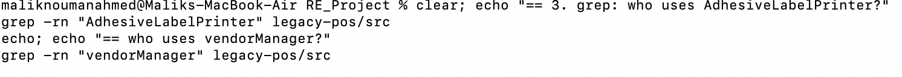

![[landscape] Step 3 result: AdhesiveLabelPrinter occurs only in its own file; vendorManager only where it is created](screenshots/member-a/step3-grep-obsolete-result.png)

**Tool evidence, step 4: measuring smell indicators with grep.**

`grep` searches the whole source tree for signs of poor quality: unfinished work (`TODO`), swallowed errors (`printStackTrace`) and business classes that import the Swing GUI library. These counts feed the metrics table above and the smell catalogue in Section 4.3.

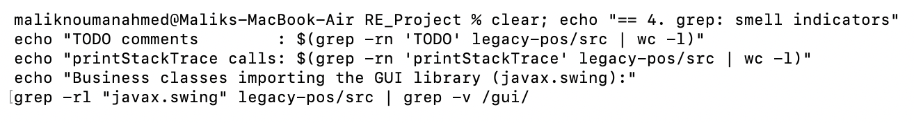

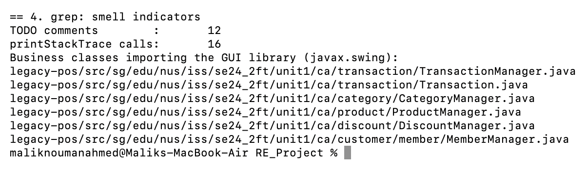

### 2.4 Tests

| ID | Class | Tests | Checks | Status | Reuse |
| --- | --- | --- | --- | --- | --- |
| TST-01 | `CategoryTest` | 4 | Construction, trimming | Active | Reusable (spec) |
| TST-02 | `CategoryManagerTest` | 3 | Load, add, duplicate/invalid IDs | Active | Reusable (spec) |
| TST-03 | `DiscountTest` | 2 | Fields, active window | Active | Reusable (spec) |
| TST-04 | `DiscountManagerTest` | 4 | Load, add, max discount | Active | Reusable (spec) |
| TST-05 | `MemberTest` | 4 | Fields, loyalty arithmetic | Active | Reusable (spec) |
| TST-06 | `MemberManagerTest` | 3 | Load, add, duplicates | Active | Reusable (spec) |
| TST-07 | `ProductTest` | 6 | Fields, understock, restock | Active | Reusable (spec) |
| TST-08 | `ProductManagerTest` | 4 | Load, ID generation, barcode uniqueness | Active | Reusable (spec) |
| TST-09 | `StoreKeeperTest` | 3 | Fields | Active | Reusable (spec) |
| TST-10 | `StoreKeeperManagerTest` | 2 | Login | Active | Reusable (spec) |
| TST-11 | `TransactionTest` | 1 | Totals | Active | Reusable (spec) |
| TST-12 | `TransactionItemTest` | 3 | Line item | Active | Reusable (spec) |
| TST-13 | `TransactionManagerTest` | 1 | Load and add a sale | Active | Reusable (spec) |
| TST-14 | `VendorTest` | 4 | Fields | Active | Reusable (spec) |
| TST-15 | `VendorManagerTest` | 1 | Vendor files load | Active | Reusable (spec) |
| TST-16 | `util/TestUtil` | – | Writes and deletes fixture files in `test/` | Active | Rework |

The tests do not cover the GUI, checkout end to end, or reloading data after a sale. That gap is why defect P1 (Section 4) went unnoticed. The test run is shown in Section 7 (tool evidence, step 7).

### 2.5 Data files

| ID | File | Rows | Columns | Status | Reuse |
| --- | --- | --- | --- | --- | --- |
| DAT-01 | `Category.dat` | 5 | code, name | Active | Reusable (data) |
| DAT-02 | `Products.dat` | 10 | `CAT/n`, name, description, qty, price, barcode, threshold, orderQty | Active | Reusable (data) |
| DAT-03 | `Members.dat` | 11 | name, memberId, loyaltyPoints (`-1` = never purchased) | Active | Reusable (data) |
| DAT-04 | `Discounts.dat` | 5 | code, description, start or `ALWAYS`, period or `ALWAYS`, percent, `M`/`A` | Active | Reusable (data) |
| DAT-05 | `Transactions.dat` | 4 | txId, productId, memberId or `PUBLIC`, qty, date | Active | Reusable (data) after repair |
| DAT-06 | `Storekeepers.dat` | 2 | name, password (plain text) | Active | Reusable (data), hash passwords |
| DAT-07 to 11 | `Vendors<CAT>.dat` (5 files) | 4 each | vendorName, description; category in the file name | Obsolete in practice (loaded, never used) | Reusable (data) |

No file ends with a newline. Five vendor files hold identical rows. All three promotions are dated 2014, so today only member discounts can apply.

### 2.6 Configuration, build, tools and documentation

| ID | Asset | Purpose | Status | Reuse | Notes |
| --- | --- | --- | --- | --- | --- |
| CFG-01 | `.classpath`, `.project` | Eclipse project | Active (IDE) | Discard | |
| CFG-02 | `unit1-ca.iml`, `.idea/*` | IntelliJ project and JAR artifact | Active (IDE) | Discard | JUnit path points into the IDE install |
| CFG-03 | `unit1-ca.eml`, `.userlibraries` | Leftovers | Obsolete | Discard | Empty |
| CFG-04 | `.gitignore` | Ignore rules | Active | Rework | |
| BLD-01 | `submission/compile.bat` | Windows compile | Active (Windows) | Discard | Typos `CompileOpiton`, `classses` |
| BLD-02 | `run.bat`, `setenv.bat` | Run; set JDK | Active (Windows) | Discard | Hard-coded `jdk1.8.0_77`; replaces `PATH` |
| BLD-03 | `submission.bat`, `submission.sh` | Build course ZIP | Obsolete | Discard | Typo `sunmission/data` |
| TOOL-01 | `tools/7z.exe`, `7z.dll` | Bundled 7-Zip | Obsolete | Discard | Binary committed to the repo |
| DOC-01 | `README.md` | Original team's git workflow | Active (partly accurate) | Rework | |
| DOC-02 | `submission/docs/report.doc` | Assumptions on points, orders, printers, barcodes, vendors | Active (accurate, incomplete) | Reusable (spec) | |

No requirements specification, architecture description, data dictionary or user guide exists. Section 3 recreates them.

### 2.7 External dependencies

| Dependency | Version | Used for | Status | Reuse decision |
| --- | --- | --- | --- | --- |
| Java SE | 1.8 (runs on 17) | Language and runtime | Active | Discard (replaced by Python 3.12) |
| `javax.swing`, `java.awt` | JDK | GUI, and table models in 6 non-GUI classes | Active | Discard (replaced by Django views and templates) |
| `java.nio.file.Files` | JDK | Reading/writing `.dat` files in 7 managers | Active | Discard (replaced by the Django ORM and a relational database) |
| `java.util.Date`, `SimpleDateFormat` | JDK | Dates, discount periods | Active | Discard (replaced by Python `datetime`) |
| JUnit / Hamcrest | 4.12 / 1.3 | Tests | Active | Discard (replaced by the Django test runner; the test assertions are reused as specification, TST-01 to 15) |
| 7-Zip | bundled | Packaging the 2016 course submission | Obsolete | Discard |
| Windows `cmd` | – | Compile and run scripts | Active (Windows only) | Discard (replaced by `requirements.txt` and `manage.py`) |

`CategoryManager`, `MemberManager`, `DiscountManager`, `ProductManager`, `TransactionManager` and `Transaction` import Swing. The business layer cannot run without a GUI.

### 2.8 Dependency maps

Package dependencies (from `import` statements). Dotted arrows are the layer violation: business classes depend on the GUI toolkit.

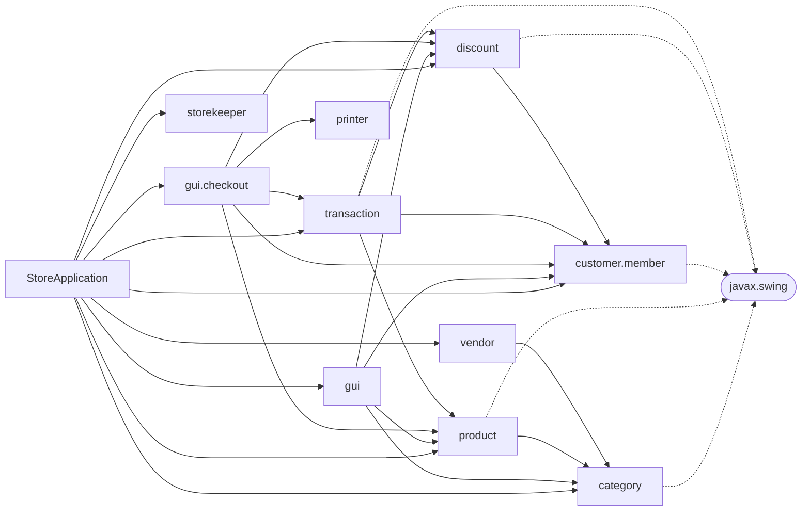

**Tool verification with jdeps.** Running `jdeps -verbose:package` on the compiled legacy classes found 39 package-to-package dependencies. All 24 arrows drawn in the package dependency diagram above are among them, and none is missing from the tool output. The 15 arrows not drawn are links to the small helper packages `util` and `customer`, left out for readability (full list: `analysis/inventory/output/jdeps-packages.txt`). `jdeps` also confirms the layer violation: exactly 5 business packages (`category`, `customer.member`, `discount`, `product`, `transaction`) depend on `javax.swing.table`.

**Tool evidence, step 5: recovering the package dependency map with jdeps.**

`jdeps`, the dependency analyser shipped with the JDK, reads the compiled legacy classes and lists every dependency between the application's packages. All 24 dependencies drawn in the package dependency diagram appear in this list; the other 15 link to the helper packages `util` and `customer`. The diagram is therefore confirmed by an official tool.

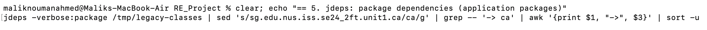

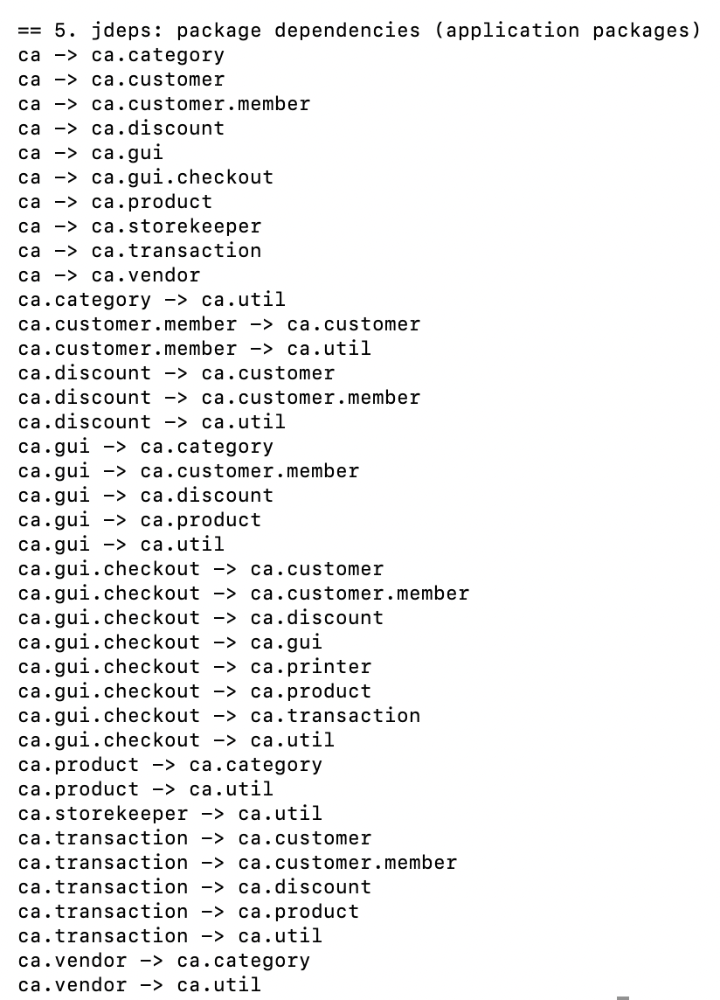

**Tool evidence, step 6: detecting the layer violation with jdeps.**

The same `jdeps` output is filtered for dependencies on `javax.swing.table`, the GUI table library. The two GUI packages (`gui`, `gui.checkout`) and the start-up class (`ca`) are expected to use it. The problem is the five business packages `category`, `customer.member`, `discount`, `product` and `transaction`: business logic depends on the user interface.

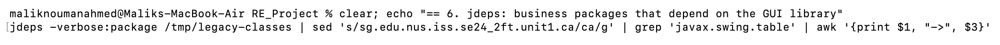

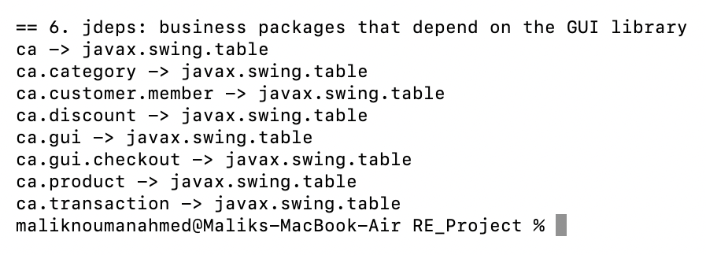

Load order at start-up. A row whose category or product is missing is silently skipped; in the database these become foreign keys.

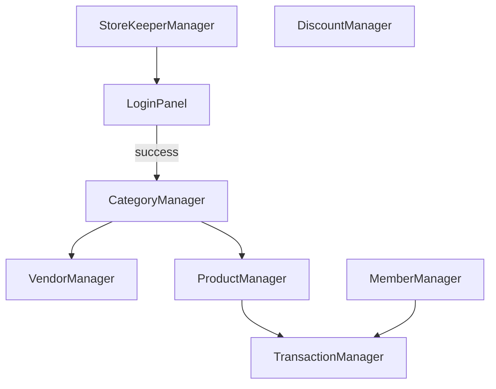

Implicit foreign keys between data files:

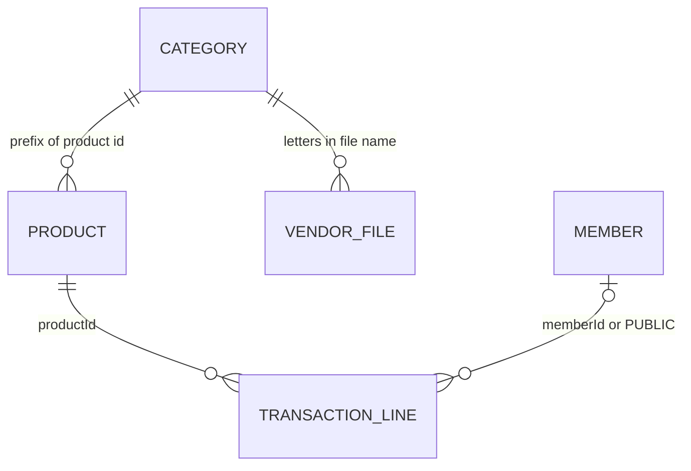

### 2.9 Inventory conclusions

| # | Finding | Evidence | Feeds |
| --- | --- | --- | --- |
| INV-1 | Each Manager mixes file I/O, validation, business rules and a Swing table model | SRC-04/08/10/12/17 | Smells, layering |
| INV-2 | Persistence is 11 hand-parsed CSV files: no escaping, schema or transactions | DAT-01 to 11 | Data restructuring |
| INV-3 | Dead code: label printer, printer id/tag, unused VendorManager, unused constructors, 62 commented-out lines | SRC-19/20/22/24 | Code restructuring |
| INV-4 | Windows-only build with a hard-coded JDK; no dependency management | BLD-01/02 | Forward engineering |
| INV-5 | Vendor data duplicated across 5 files; categories encoded in names and IDs | DAT-07 to 11, DAT-02 | Normalisation |
| INV-6 | Legacy tests pass but miss checkout, persistence round-trips and GUI | TST-01 to 16 | Regression suite |
| INV-7 | No real documentation exists | DOC-01/02 | Phase 2 |
| INV-8 | Passwords stored in plain text | DAT-06 | Risk R-09 |

## 3. Phase 2: Document Restructuring (Legacy Documentation)

The legacy system is a single-user Swing POS with 8 features, no service or data-access layer, and 18 business rules spread across entities, managers and dialogs. This section recreates its missing documentation from the code; it forms documentation set A (legacy, reverse-engineered).

### 3.1 System overview

| Item | Description |
| --- | --- |
| Purpose | Point-of-sale and back office for a small university souvenir shop |
| Users | Storekeeper (the only actor who logs in). Customers are members (earn/redeem points) or public (anonymous). |
| Deployment | Java Swing desktop application on one workstation |
| Persistence | 11 comma-separated files in `data/`, relative to the working directory |
| Hardware | Receipt printer and barcode reader simulated: receipts go to the console, IDs are typed |

### 3.2 Features as implemented

| ID | Feature | Screen | Back-end method |
| --- | --- | --- | --- |
| F1 | Storekeeper login | `LoginPanel` (modal at start-up) | `StoreKeeperManager.login` |
| F2 | Checkout | Checkout tab, payment and receipt dialogs | `TransactionManager.addTransaction` |
| F3 | Add category | New Category tab | `CategoryManager.addCategory` |
| F4 | Add member | New Member tab | `MemberManager.addMember` |
| F5 | Add product | New Product tab | `ProductManager.addProduct` |
| F6 | Understock list and purchase order | Inventory tab | `ProductManager.generatePurchaseOrder` |
| F7 | Add discount | Discount tab | `DiscountManager.addDiscount` |
| F8 | Category, product, transaction (date range) and member reports | Reports tab | Table models of 4 managers |

Not implemented: update or delete of any record, vendor screens, storekeeper management, refunds, multiple users.

Use-case diagram (recovered from the seven tabs registered in `StoreApplication.java:105-111`, the login dialog and the optional buttons of the checkout screens). The Storekeeper is the only actor; member identification, point redemption and receipt printing are optional extensions of checkout.

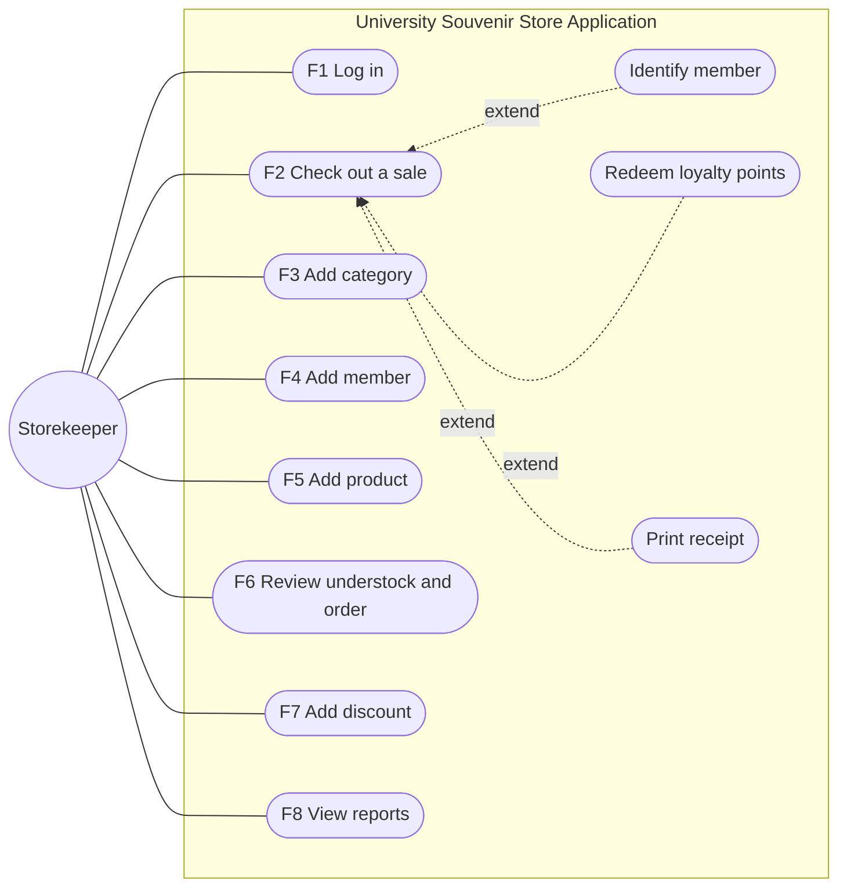

### 3.3 Recovered architecture

The system is two-tier and tightly coupled. Each Manager class plays three roles at once.

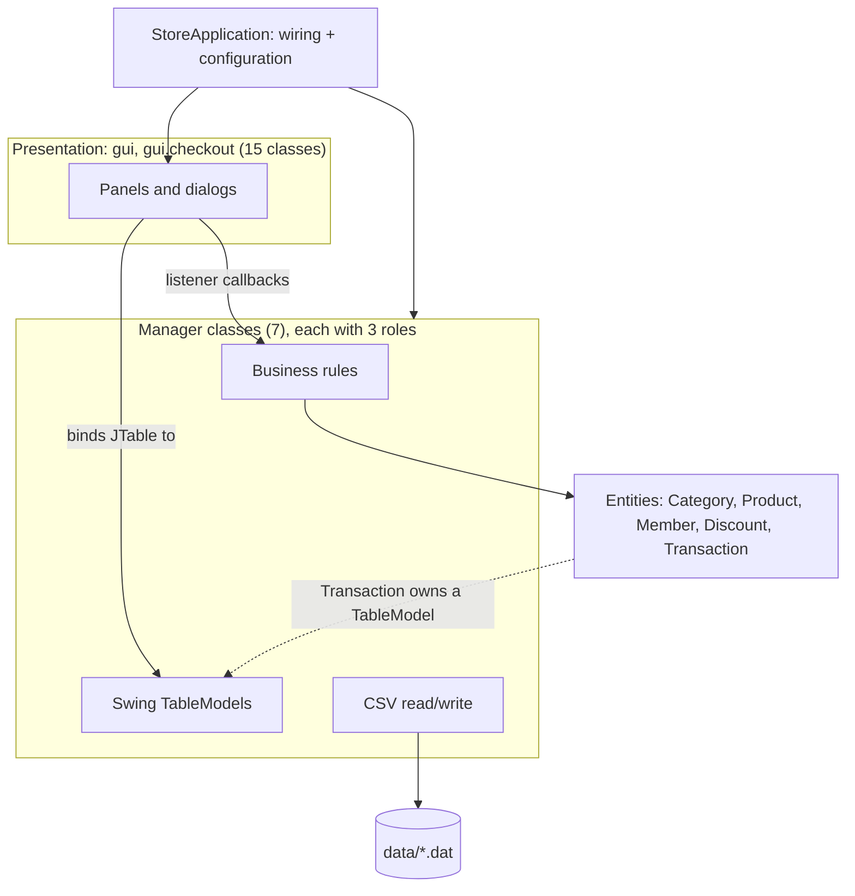

1. No service layer. Rules sit in entities (`Discount.isDiscountAvailable`), managers (`DiscountManager.getMaxDiscount`) and dialogs (`ConfirmPaymentDialog` recomputes the redemption cap).
2. No data-access layer. Seven managers each parse and write CSV with copied code.
3. Presentation leaks into the domain. Managers and `Transaction` build `AbstractTableModel` objects.
4. Configuration lives in code: file paths, loyalty rates (`DOLLAR_TO_POINT = 10`, `POINT_TO_DOLLAR = 5`) and discount codes.

| Pattern already present | Where | Assessment |
| --- | --- | --- |
| Observer | `*PanelListener` interfaces wired in `StoreApplication` | Good; kept |
| Singleton | `PublicCustomer.getInstance()` | Represents the anonymous customer |
| Template Method | Abstract `LoginPanel.login`, `CheckoutPanel.getProduct/getMember/getDiscount` | Manual dependency injection |
| Lazy initialisation | `getTableModel()` in each manager | Causes a `NullPointerException` when used before the GUI exists |

### 3.4 Module inventory

| Package | Classes | Responsibility | Should belong to |
| --- | --- | --- | --- |
| root | `StoreApplication` | Start-up, login gate, wiring | Composition root |
| `category` | `Category`, `CategoryManager` | Categories | Domain + service + repository + UI (mixed) |
| `customer` | `Customer`, `PublicCustomer` | Customer abstraction | Domain |
| `customer.member` | `Member`, `MemberManager` | Members, loyalty points | Mixed |
| `discount` | `Discount`, `DiscountManager` | Discounts, best-discount selection | Mixed |
| `product` | `Product`, `ProductManager` | Products, stock, ID generation, purchase order | Mixed |
| `storekeeper` | `StoreKeeper`, `StoreKeeperManager` | Login | Domain + service + repository |
| `transaction` | `Transaction`, `TransactionItem`, `TransactionManager` | Sales, totals, payment, points | Mixed |
| `vendor` | `Vendor`, `VendorManager` | Vendors per category (loaded only) | Domain + repository |
| `printer` | 3 printer classes | Console printing | Infrastructure |
| `util` | `Util` | Parsing, formatting, CSV split | Cross-cutting |
| `gui` | 11 classes | Swing screens | Presentation |
| `gui.checkout` | 4 classes | Sale screens | Presentation (holds business rules) |

### 3.5 Recovered class diagram

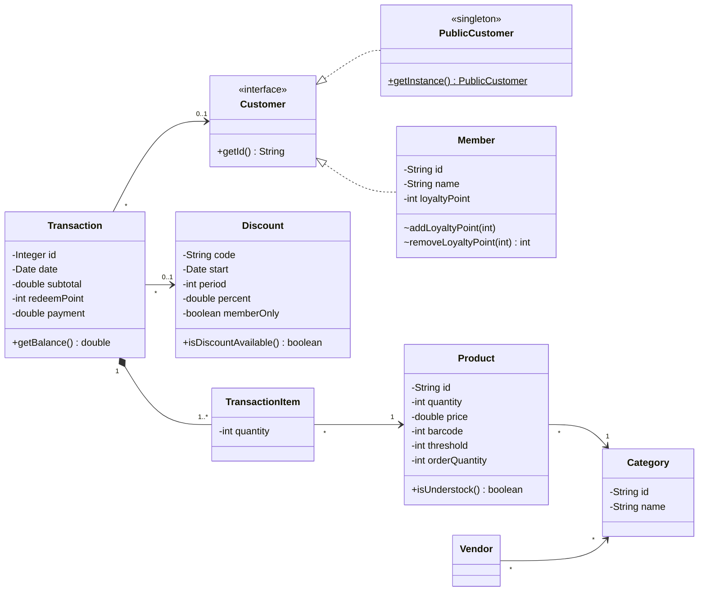

Encoded meanings hidden from the diagram: `loyaltyPoint = -1` means never purchased; `Discount.start = null` and `period = -1` mean ALWAYS; `Product.id` has the form `CAT/n`.

### 3.6 Checkout interaction (F2)

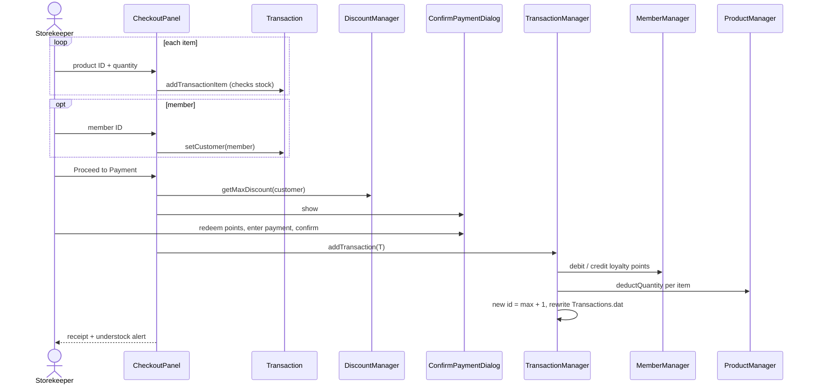

### 3.7 Data dictionary

All files are UTF-8, comma-separated, with no header, quoting or escaping. Each change rewrites the whole file sorted by ID.

| File | Column | Type | Rule enforced by code |
| --- | --- | --- | --- |
| `Category.dat` | code | text | Exactly 3 characters, unique |
| | name | text | Trimmed, not validated |
| `Products.dat` | id | `CAT/n` | Unique; prefix must be an existing category; `n` = max in category + 1 |
| | name, description | text | Not validated |
| | quantity | int | 0 when unparsable |
| | price | `double` | 0 when unparsable |
| | barcode | int | Unique |
| | threshold | int | Understock when quantity ≤ threshold |
| | orderQuantity | int | Added by a purchase order |
| `Members.dat` | name | text | – |
| | memberId | text | Unique, not blank |
| | loyaltyPoints | int | `-1` = never purchased |
| `Discounts.dat` | code | text | Upper-cased, unique |
| | description | text | – |
| | startDate | `yyyy-MM-dd` or `ALWAYS` | `ALWAYS` stored as null |
| | periodDays | int or `ALWAYS` | `ALWAYS` stored as -1 |
| | percent | decimal | Written back as `20.0` |
| | applicableTo | `M` or `A` | Members only or all |
| `Transactions.dat` | transactionId | int | Repeated on each line of a sale |
| | productId | text | Must exist |
| | memberId | text or `PUBLIC` | Repeated on each line |
| | quantity | int | – |
| | date | `yyyy-MM-dd` | Repeated on each line |
| `Storekeepers.dat` | name, password | text | Plain-text password; case-sensitive name |
| `Vendors<CAT>.dat` | vendorName, description | text | Category = letters 8 to 10 of the file name |

Not stored for a sale: unit price, discount, points redeemed or earned, amount paid. A past receipt cannot be reproduced.

### 3.8 Business rules catalogue

| ID | Rule | Source |
| --- | --- | --- |
| BR-01 | Login succeeds when the name exists and the password matches exactly; closing the dialog exits | `StoreKeeperManager.java:51-55` |
| BR-02 | Category code: non-blank, exactly 3 characters, unique | `CategoryManager.java:66-73` |
| BR-03 | Member ID: non-blank, unique; a new member starts at `-1` | `MemberManager.java:56-61` |
| BR-04 | Product needs an existing category and a unique barcode; ID = `<category>/<max+1>` | `ProductManager.java:88-107` |
| BR-05 | Understock when quantity ≤ threshold | `Product.java:49` |
| BR-06 | A purchase order adds `orderQuantity` to each selected understock product at once | `ProductManager.java:155-172` |
| BR-07 | A discount is active when start is ALWAYS, or start ≤ now ≤ start + period days at 23:59:59 | `Discount.java:56-66` |
| BR-08 | One discount per sale: the eligible active one with the highest percent | `DiscountManager.java:57-75` |
| BR-09 | `M` discounts never apply to the public; `MEMBER_FIRST` only at `-1`, `MEMBER_SUBSEQ` otherwise (verified) | `DiscountManager.java:61-70` |
| BR-10 | Cumulative quantity per product is checked against stock; same product merged; quantity 1 to 9999 | `Transaction.java:152-179` |
| BR-11 | Subtotal = Σ quantity × price; discount = subtotal × percent / 100; total = subtotal − discount | `Transaction.java:68-76` |
| BR-12 | 1 point = $5; maximum redeemable = min(points, floor(total / 5)) | `TransactionManager.java:159-164` |
| BR-13 | Earn floor(subtotal before discount / 10) points; a first purchase replaces `-1` | `TransactionManager.java:170-180` |
| BR-14 | Payment ≥ 0 with at most 2 decimals; confirm only when payment + redemption ≥ total | `ConfirmPaymentDialog.java:206-234` |
| BR-15 | On confirm: deduct stock, id = max + 1, date = today, alert sold items now understock | `TransactionManager.java:182-207` |
| BR-16 | Discount entry: blank start or period = ALWAYS; fractional period rejected; bad percent = 0; code upper-cased | `DiscountPanel.java:190-213` |
| BR-17 | Transaction report filters an inclusive date range, defaulting to the first and last sale | `ReportPanel.java:98-117` |
| BR-18 | No record can be modified or deleted | `report.doc` |

### 3.9 Configuration and operation

| Topic | Legacy behaviour |
| --- | --- |
| Install | Clone, then copy `data-sample` to `data` |
| Build | IDE, or `submission/compile.bat` (Windows, JDK 1.8) |
| Run | `java -cp classes sg.edu.nus.iss.se24_2ft.unit1.ca.StoreApplication` from the folder holding `data/` |
| Logins | `Stacy` / `Dean56s`, `Johny` / `A12ysd45` |
| Runtime settings | None; paths, rates and codes need a recompile |
| Errors | `printStackTrace()` to the console, plus message dialogs |

## 4. Dependencies, Limitations and Smells

The most serious legacy defect destroys member history: after any new sale, every earlier member transaction is rewritten as `PUBLIC`. It and seven more defects were reproduced by running the legacy code; dependencies are listed in Sections 2.7 and 2.8.

### 4.1 Defects verified by execution

A probe program (`analysis/legacy-bug-probe/Probe.java`, run with `run-probe.sh`) calls the unmodified legacy classes on copies of `data-sample/`. Its run is shown in Section 7 (tool evidence, step 8).

| Probe | Defect | Location | Observed output |
| --- | --- | --- | --- |
| P1 | Inverted check on load turns member sales into `PUBLIC`; the next save makes it permanent | `TransactionManager.java:78-80` | `1,CLO/1,F42563743156,2,…` became `1,CLO/1,PUBLIC,2,…` |
| P2 | Stock deduction crashes when the understock table model was never created | `ProductManager.java:146-150` | `NullPointerException` on `understockTableModel` |
| P3 | Lower-case category accepted but unreachable | `CategoryManager.java:54, 66-77` | `getCategory("bks") = null` |
| P4 | A comma in a name corrupts the row | `Util.splitCsv` | `Mug, Large` reloaded as name `Mug`, description `Large`, qty 0, price 10.0 |
| P5 | One malformed line stops start-up | every `load()` | `ArrayIndexOutOfBoundsException` from the constructor |
| P6 | Duplicate discount silently ignored | `DiscountManager.java:84` | `addDiscount` returns `false`; GUI ignores it |
| P7 | 2014 promotions expired; only member discounts apply | `Discounts.dat` | public: none; new member: `MEMBER_FIRST`; existing: `MEMBER_SUBSEQ` |
| P8 | Sale ID read before saving throws | `Transaction.java:52` | `NullPointerException` (Integer unboxing) |

### 4.2 Limitations and weaknesses

| ID | Limitation | Evidence | Impact |
| --- | --- | --- | --- |
| L-01 | Member history destroyed after any sale (verified, P1) | `TransactionManager.java:78-80` | Permanent data loss; wrong member reports |
| L-02 | Commas corrupt data (verified, P4) | `Util.splitCsv` | Silent corruption |
| L-03 | One bad line stops the application (verified, P5) | all `load()` methods | Cannot start |
| L-04 | Lower-case category unreachable (verified, P3) | `CategoryManager.java:54-77` | Products cannot be added to it |
| L-05 | Duplicate discount ignored silently (verified, P6) | `StoreApplication.java:61` | User believes it was saved |
| L-06 | Stock deduction can crash (verified, P2) | `ProductManager.java:146-150` | `NullPointerException` |
| L-07 | Sales do not store price, discount, redemption or payment | `TransactionItem.toString` | No audit of receipts or revenue |
| L-08 | Money in `double`: receipt shows $73.65 − $7.37 = $66.29 | `Transaction`, `Util.formatDollar` | 1-cent errors |
| L-09 | Plain-text passwords | `Storekeepers.dat` | Security |
| L-10 | No update/delete, no vendor UI, single user, whole-file rewrites | all managers | Functional limits, lost updates |
| L-11 | Redemption cap computed in 3 places, one comparing points with dollars | `ConfirmPaymentDialog.java:158-184`, `Transaction.java:206-207` | Inconsistent behaviour |
| L-12 | Back end assumes a GUI exists | `ProductManager.java:149` | Cannot run headless or as an API |
| L-13 | Hard-coded paths, rates and discount codes | `StoreApplication.java:31-48` | Recompile for every change |
| L-14 | Windows-only build with a fixed JDK path | `compile.bat`, `setenv.bat` | Hard to build |
| L-15 | Errors swallowed in 16 places | all managers | Failures unnoticed |
| L-16 | Wrong component made visible on the payment screen | `ConfirmPaymentDialog.java:110, 116-117` | Confusing UI for public customers |
| L-17 | All promotions expired (verified, P7) | `Discounts.dat` | Tests must fix the current date |

### 4.3 Code smells identified

Smells found while building the inventory and the legacy documentation. Phase 3 (Reverse Engineering, Member B) analyses them in depth; Section 6 and the handoff in Section 8 show which refactoring removes each one.

| ID | Smell | Where | Removed by |
| --- | --- | --- | --- |
| S-01 | God class / divergent change: each Manager mixes CSV I/O, validation, business rules and a Swing table model | `ProductManager` (247 LOC, 19 methods) and 4 other Managers | B1, C1 |
| S-02 | Duplicated code: 7 copies of `load()`/`store()`, 7 near-identical `getTableModel()` | all Managers; `ProductManager.java:174-234` | B1, C1 |
| S-03 | Large class / long method | `ConfirmPaymentDialog.getPaymentPanel()` about 200 lines | C1, C2 |
| S-04 | Misplaced business logic: redemption cap computed in 3 places, one comparing points with dollars | `ConfirmPaymentDialog.java:158-184`, `Transaction.java:206-207`, `TransactionManager.java:159-164` | C2 |
| S-05 | Layer violation: `javax.swing` in 6 non-GUI classes | Managers, `Transaction` | C1 |
| S-06 | Magic numbers and strings: `-1`, `"ALWAYS"`, `"PUBLIC"`, `"M"`/`"A"`, `"MEMBER_FIRST"` | `Member`, `Discount`, `DiscountManager` | A1, C3 |
| S-07 | Primitive obsession: money as `double`, category encoded in product ID string | `Product`, `Transaction` | A3, B |
| S-08 | Dead code: label printer, printer id/tag, unused `VendorManager`, unused constructors and imports, about 62 commented-out lines | SRC-19/20/22/24, `ProductPanel` imports | not carried forward |
| S-09 | Swallowed exceptions: 16 × `printStackTrace()` | all Managers | B3 |
| S-10 | Temporal coupling: `requestedId` + `setId()`; transaction locked once id is set | `Category`, `Member`, `Discount`, `TransactionManager.java:82` | A2 |
| S-11 | Inappropriate intimacy: GUI reads `TransactionManager` point-rate constants | `ConfirmPaymentDialog`, `ReceiptDialog` | C2 |
| S-12 | Copy-paste error: wrong component made visible | `ConfirmPaymentDialog.java:110, 116-117` | C1 |
| S-13 | Global mutable state: shared static `SimpleDateFormat` | `Util.DATE_FORMAT` | not carried forward |

**SonarQube view 5: cyclomatic complexity.**

The cyclomatic complexity of the legacy code is 541.

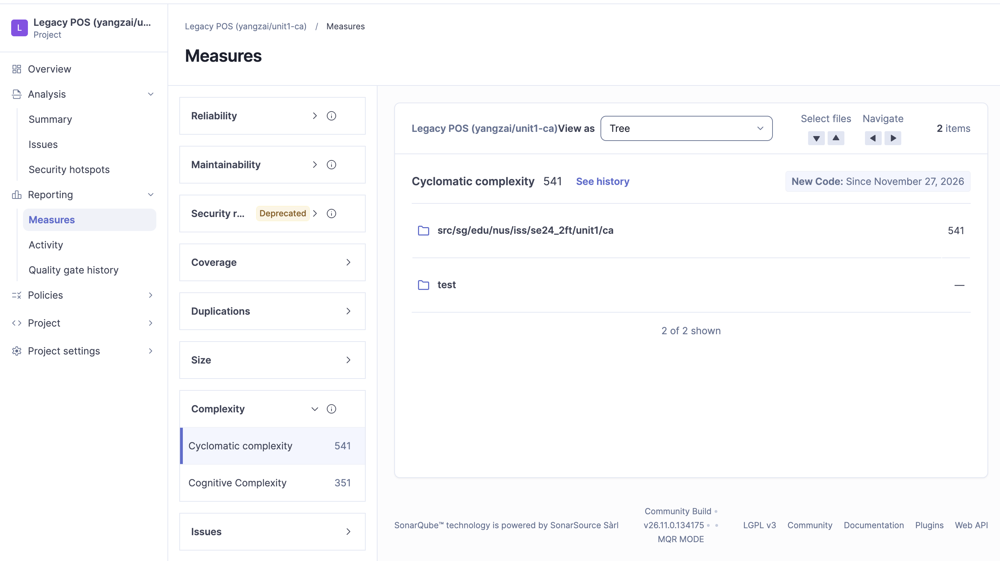

**SonarQube view 6: cognitive complexity.**

The cognitive complexity of the legacy code is 351.

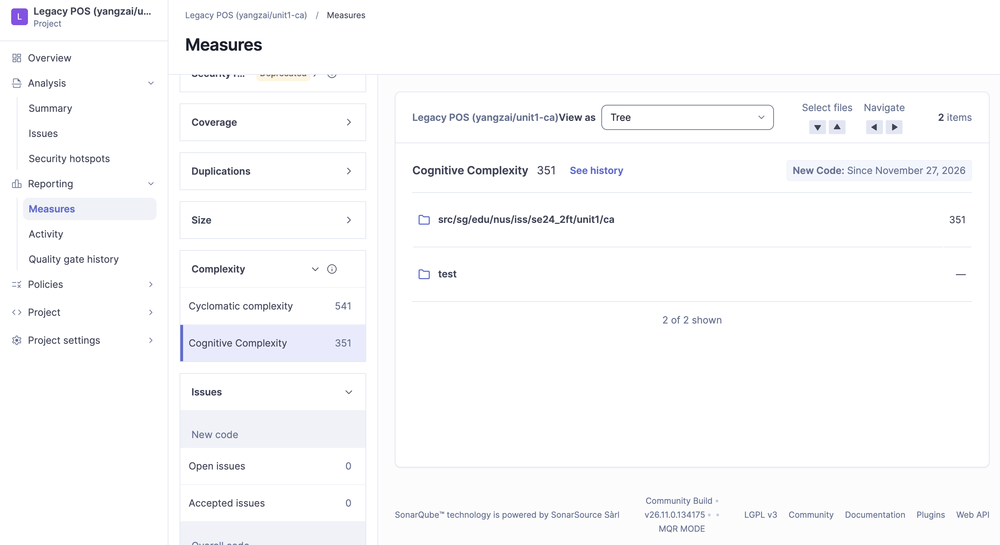

**SonarQube view 7: duplication.**

SonarQube finds 6 duplicated blocks (82 lines) in 4 files, 2.1% of the code: `CategoryManager`, `ProductManager`, `Transaction` and `TransactionManager`. This is the copied table-model and file-handling code of smell S-02.

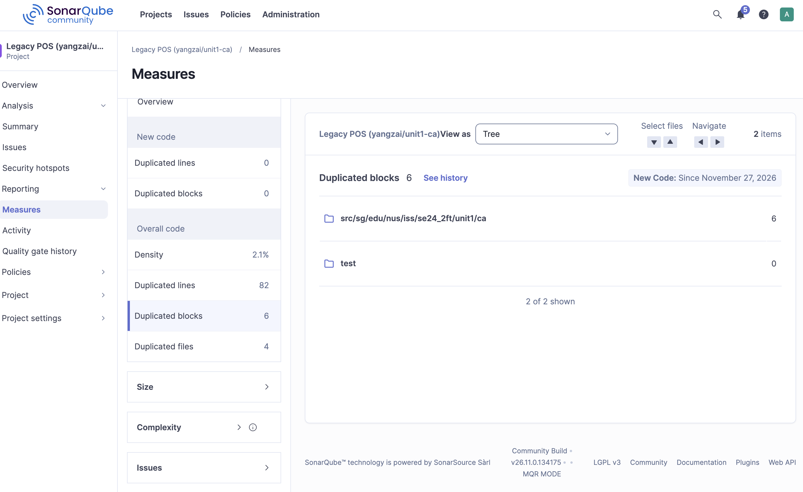

**SonarQube view 8: all issues.**

The Issues view lists 16 security, 1 reliability and 92 maintainability issues. The first issue is the shared static `SimpleDateFormat` in `Util` (smell S-13).

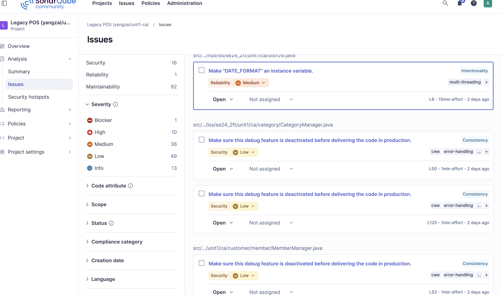

**SonarQube view 9: TODO comments.**

The TODO rule reports 13 issues: the 12 TODO comments in production code counted in 2.2, plus 1 in a test file.

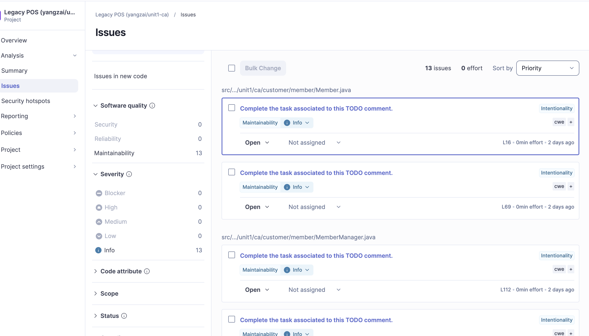

**SonarQube view 10: printStackTrace calls.**

The rule "Make sure this debug feature is deactivated before delivering the code in production" reports 16 issues, the 16 `printStackTrace()` calls of smell S-09.

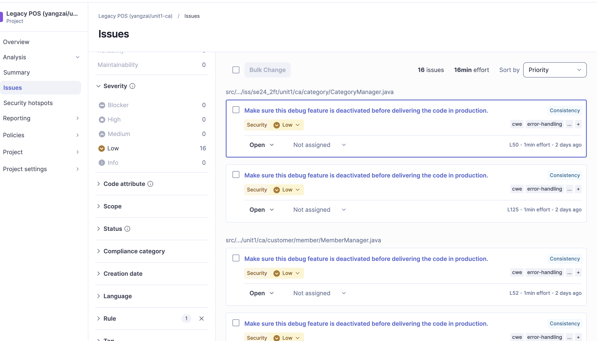

### 4.4 Data smells identified

| ID | Data smell | Planned fix (Phase 5, Member B) |
| --- | --- | --- |
| DS-1 | `Transactions.dat` repeats member ID and date on every line of a sale | Separate `sale` and `sale_line` tables |
| DS-2 | Unit price, discount, points and payment of a sale are not stored | Store them on `sale` / `sale_line` |
| DS-3 | Category encoded inside the product ID (`CLO/1`) | `product.category_code` foreign key |
| DS-4 | Category encoded in vendor file names; identical rows in 5 files | `vendor` + `vendor_category` tables |
| DS-5 | Sentinels: `-1` points, `ALWAYS` dates, `M`/`A` flag | `has_purchased` boolean (A1), nullable dates, explicit `applies_to` |
| DS-6 | `PUBLIC` pseudo member ID | Nullable member foreign key |
| DS-7 | Plain-text passwords | Password hash |
| DS-8 | No quoting, escaping, header or schema | Typed relational schema with constraints |
| DS-9 | Spelling errors in data ("Stationary", "Sovenirs", "momento") | Keep or clean during migration, logged either way |
| DS-10 | Working data may already be damaged by defect P1 | Migrate from untouched `data-sample/`, with a validation report |

## 5. Risk Register

Three of 17 risks are rated High: the 6-day schedule (R-01), losing a legacy business rule (R-02) and corrupt data during migration (R-03). Likelihood (L) and impact (I) are rated 1 to 5; score = L × I, where 1–6 is Low, 8–12 Medium and 15–25 High. The register is reviewed at the end of each phase and before submission.

| ID | Phase | Risk | Category | L | I | Score | Mitigation | Owner | Status |
| --- | --- | --- | --- | --- | --- | --- | --- | --- | --- |
| R-01 | All | Only 6 days remain; phases may be rushed | Project | 4 | 5 | 20 High | Daily plan with owners; phases 1–3 in parallel; scope frozen; minimum complete version by 30 Nov | All (A tracks) | Open |
| R-02 | 3, 6 | New system fails to reproduce a legacy business rule | Technical | 3 | 5 | 15 High | Rules BR-01 to BR-18 catalogued; one regression test per rule; legacy test assertions reused | C | Open |
| R-03 | 5 | Data corrupted during migration (L-01 damage, L-02 commas) | Data | 4 | 4 | 16 High | Migrate from untouched `data-sample/`; check row counts and foreign keys; log rejected rows | B | Open |
| R-04 | 3, 6 | "Preserve functionality" conflicts with known defects | Requirements | 4 | 3 | 12 Medium | Fix only defects that break documented intent; record each as an intentional deviation with a test | A + C | Open |
| R-05 | 6 | Learning curve of the chosen stack | People | 3 | 4 | 12 Medium | Stack chosen by team skill; day-1 spike; pair programming | All | Open |
| R-06 | 6 | Integration problems between layers built by different members | Technical | 3 | 4 | 12 Medium | Agree service and repository signatures first; integrate daily; small pull requests | C | Open |
| R-07 | All | A member's work missing from git history | Process | 3 | 4 | 12 Medium | Everyone commits their own work under their own name; check `git shortlog -sn` daily | A | Open |
| R-08 | All | Similarity check flags copied text or code | Compliance | 2 | 5 | 10 Medium | Own wording; cite the legacy repository; no copying of published solutions | All | Open |
| R-09 | 5, 6 | Plain-text passwords carried into the database | Security | 3 | 3 | 9 Medium | Hash passwords during migration; never log credentials | B | Open |
| R-10 | 6 | Cent errors from floating-point money | Technical | 4 | 2 | 8 Medium | `Money` value object (A3); `DECIMAL(10,2)` columns; half-up rounding in one place | A + B | Open |
| R-11 | 6 | Discount tests depend on today's date | Testing | 4 | 2 | 8 Medium | Pass the date into the discount service; fixed dates in tests | C | Open |
| R-12 | 3 | Undocumented legacy behaviour misunderstood | Technical | 2 | 4 | 8 Medium | Defect probes run; 45 legacy tests re-run (all pass) | A | Mitigated |
| R-13 | 5 | Curly apostrophes break with the wrong encoding | Data | 2 | 2 | 4 Low | Read files as UTF-8; UTF-8 database | B | Open |
| R-14 | 6 | Environment differences; Django 5.2 does not support Python 3.15 | Technical | 3 | 3 | 9 Medium | Python 3.12/3.13 virtual environment; pinned `requirements.txt` | C | Open |
| R-15 | All | Documentation drifts from the code | Process | 3 | 3 | 9 Medium | Each refactoring linked to its commit; final consistency review 30 Nov | A | Open |
| R-16 | Presentation | A member cannot explain their own work | People | 2 | 4 | 8 Medium | Each member presents their own part; dry run 1 Dec | All | Open |
| R-17 | 6 | Scope creep beyond legacy features | Project | 3 | 3 | 9 Medium | No new features; any extra justified by the architecture | A | Open |

## 6. Code Restructuring: Refactorings A1–A3

Member A performed three domain-model refactorings, each committed separately and covered by tests that pin the legacy behaviour. Each one traces to an inventory (INV) or limitation (L) finding. "Before" is the legacy Java; "after" is the Django code in `reengineered/`.

| # | Refactoring | Smell removed | Traces to | Commit | Tests |
| --- | --- | --- | --- | --- | --- |
| A1 | Replace magic number with explicit state | `-1` used as "never purchased" | BR-03, BR-09, BR-13 | `d7579b1` | 12 |
| A2 | Remove setting method; move validation into the entity | Two-step ID set-up; inconsistent validation | L-04 (P3) | `4dda7ef` | 17 |
| A3 | Replace primitive with object (Money) | Money held in `double` | L-08, R-10 | `31f0468` | 15 |

### 6.1 A1: Replace the `-1` sentinel with explicit state

**Smell:** magic number used as a type code. `loyaltyPoint == -1` means "never purchased", and 4 classes in 3 packages repeat that check (`Member.java:21, 53-60`, `MemberManager.java:38`, `DiscountManager.java:63-68`, `ConfirmPaymentDialog.java:159-160`).

Before (legacy Java):

```java
// Member.java
loyaltyPoint = -1;                                      // magic value
void addLoyaltyPoint(int loyaltyPoint) {
    if (this.loyaltyPoint < 0) setLoyaltyPoint(loyaltyPoint);
    else this.loyaltyPoint += loyaltyPoint;
}
// DiscountManager.java
if (code.equals("MEMBER_FIRST") && loyaltyPoint != -1) return false;
if (code.equals("MEMBER_SUBSEQ") && loyaltyPoint == -1) return false;
// ConfirmPaymentDialog.java
if (memberPoint < 0) memberPoint = 0;                   // GUI must know about -1 too
```

After (`reengineered/members/models.py`):

```python
class Member(models.Model):
    member_id = models.CharField(max_length=20, unique=True)
    name = models.CharField(max_length=100)
    loyalty_points = models.PositiveIntegerField(default=0)   # never negative
    has_purchased = models.BooleanField(default=False)        # replaces -1

    @classmethod
    def from_legacy(cls, name, member_id, legacy_points):
        if legacy_points < 0:
            return cls(member_id=member_id, name=name, loyalty_points=0, has_purchased=False)
        return cls(member_id=member_id, name=name, loyalty_points=legacy_points, has_purchased=True)

    @property
    def is_first_purchase(self):
        return not self.has_purchased

    def redeem(self, points):
        if points < 0 or points > self.loyalty_points:
            raise ValidationError("Loyalty Point is not enough")
        self.loyalty_points -= points

    def record_purchase(self, earned_points):
        if earned_points < 0:
            raise ValidationError("Earned points cannot be negative")
        self.loyalty_points += earned_points
        self.has_purchased = True
```

Mechanics: legacy behaviour written as tests first; field and query added; `addLoyaltyPoint`/`removeLoyaltyPoint` replaced by `record_purchase`/`redeem`; legacy rows converted by `from_legacy`.

| Case | Legacy | New |
| --- | --- | --- |
| `Members.dat` value `-1` | sentinel | 0 points, `has_purchased = False` |
| `Members.dat` value 150 | 150 | 150 points, `has_purchased = True` |
| First purchase, $73.65 subtotal | −1 → 7 | 0 → 7, first purchase over |
| First purchase under $10 | −1 → 0, then `MEMBER_SUBSEQ` | 0, first purchase over |
| Redeem 13 then earn 7 from 150 | 144 | 144 |
| Redeem more than balance | "Loyalty Point is not enough" | same message |

### 6.2 A2: Self-validating Category and Member

**Smell:** temporal coupling and inconsistent validation. Entities were built half-empty (`requestedId`, `id = null`); the manager validated them, differently in `load()` and `addCategory()`, then called `setId()`. Lookup upper-cased the code but storage did not, so `bks` was stored and never found (L-04, probe P3).

Before (legacy Java):

```java
public Category(String requestedId, String name) {
    id = null;                                          // half-built object
    this.requestedId = (requestedId != null ? requestedId.trim() : null);
}
/*package*/ void setId() { id = requestedId; }          // must be called later
// CategoryManager.addCategory
if (categoryId == null || categoryId.isEmpty()) throw ...("Category ID is blank, please input again");
if (categoryMap.get(categoryId) != null)       throw ...("Category " + categoryId + " already existed...");
if (categoryId.length() != 3)                  throw ...("Category ID must be three letter code");
public Category getCategory(String id) { return categoryMap.get(id.toUpperCase()); }
```

After (`reengineered/inventory/models.py`, `inventory/services.py`):

```python
CATEGORY_CODE = re.compile(r"^[A-Z]{3}$")

class Category(models.Model):
    code = models.CharField(max_length=3, primary_key=True)
    name = models.CharField(max_length=100, blank=True)

    def clean(self):
        self.code = (self.code or "").strip().upper()
        self.name = (self.name or "").strip()
        if not self.code:
            raise ValidationError("Category ID is blank, please input again")
        if not CATEGORY_CODE.match(self.code):
            raise ValidationError("Category ID must be three letter code")

    def save(self, *args, **kwargs):
        self.clean()            # every path is validated
        super().save(*args, **kwargs)

def add_category(code, name):
    category = Category(code=code, name=name)
    category.clean()
    if Category.objects.filter(code=category.code).exists():
        raise ValidationError(f"Category {category.code} already existed. Please input again")
    category.save()
    return category
```

`Member` received the same treatment: `clean()` trims the ID and rejects a blank one ("Member ID field is blank. Please input again"); `add_member` keeps the duplicate check; IDs stay case-sensitive as in legacy.

| Input | Legacy | New | Note |
| --- | --- | --- | --- |
| `CLO` | accepted | accepted | |
| blank | "Category ID is blank…" | same | |
| `CL`, `CLOT` | "…three letter code" | same | |
| duplicate `CLO` | "Category CLO already existed…" | same | |
| `bks` | stored, then unreachable | stored as `BKS` | Deviation D-A2a |
| `AB1` | accepted | rejected | Deviation D-A2b: matches legacy message and vendor rule `[A-Z]{3}` |

### 6.3 A3: Money value object instead of `double`

**Smell:** primitive obsession. Prices, subtotal, discount and payment were `double`, rounded only when printed. Legacy sample transaction 1 (2 × CLO/1 at 21.45, 3 × MUG/1 at 10.25, 10% discount) computes discount 7.365000000000001 and total 66.28500000000001, and prints Subtotal $73.65, Discount $7.37, Total $66.29, which does not add up.

Before (legacy Java):

```java
private double price;                                    // Product
public double getDiscountAmount() {
    return (discount.getPercent() / 100.0) * subtotal;   // 7.365000000000001
}
public static String formatDollar(double amount) {       // rounding only here
    return "$" + String.format("%.2f", amount);
}
```

After (`reengineered/core/money.py`, abridged):

```python
@dataclass(frozen=True, order=True)
class Money:
    amount: Decimal                                     # always 2 decimals

    def __post_init__(self):
        if isinstance(self.amount, float):
            raise TypeError("Money cannot be created from float")
        object.__setattr__(self, "amount",
            Decimal(self.amount).quantize(CENT, rounding=ROUND_HALF_UP))

    def times(self, quantity): return Money(self.amount * quantity)
    def percent_of(self, percent):                      # rounded once
        return Money(self.amount * Decimal(str(percent)) / 100)
    def whole_units_of(self, divisor):                  # floor: points /10, redeem /5
        return int((self.amount / divisor).to_integral_value(rounding=ROUND_FLOOR))
    def __str__(self): return f"${self.amount}"
```

| Case | Legacy | New |
| --- | --- | --- |
| Subtotal | $73.65 | $73.65 |
| Discount 10% | $7.37 | $7.37 |
| Total | $66.29 (inconsistent) | $66.28. Deviation D-A3 |
| Points earned (floor ÷ 10) | 7 | 7 |
| Maximum redeemable (floor ÷ 5) | 13 | 13 |
| Rounding 2.675 | float gives 2.67 | 2.68 (half-up) |

### 6.4 Intentional deviations

| ID | Change | Reason | Evidence |
| --- | --- | --- | --- |
| D-A2a | Category codes stored upper-case | Legacy accepted codes it could never find | Probe P3 |
| D-A2b | Category codes must be letters A–Z | Legacy error text and vendor-file rule | `CategoryManager.java:73`, `VendorManager.java:38` |
| D-A3 | Discount rounded to the cent before the total | Legacy receipt off by 1 cent | Section 6.3 |

## 7. Testing Evidence

All 45 legacy tests and all 44 new tests pass. The 8 defect probes reproduce on the unmodified legacy code.

| Test set | Runs against | Count | Result | How to run |
| --- | --- | --- | --- | --- |
| Legacy JUnit 4 suite | Legacy Java (JDK 17) | 45 | 45 pass | `JUnitCore` over `test/` (repository README) |
| Defect probes P1–P8 | Legacy Java, copies of `data-sample/` | 8 | All 8 defects reproduced | `./analysis/legacy-bug-probe/run-probe.sh` |
| A1 member loyalty | Django `members` | 12 | Pass | `python manage.py test members` |
| A2 category and member validation | Django `inventory`, `members` | 17 | Pass | `python manage.py test inventory members` |
| A3 money | Django `core` | 15 | Pass | `python manage.py test core` |

**Tool evidence, step 7: running the legacy test suite with javac and JUnit.**

The legacy source and tests are compiled with `javac` and the 15 JUnit test classes are executed. All 45 tests pass, which confirms the legacy system works as a baseline and that its tests can be reused as a behavioural specification (Reuse: spec).

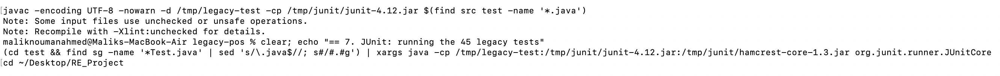

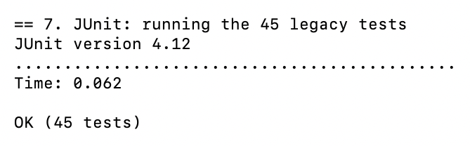

**Tool evidence, step 8: confirming the legacy defects with the probe program.**

The probe program (`analysis/legacy-bug-probe/run-probe.sh`) compiles the unmodified legacy classes and calls them on copies of the sample data. Each output line reproduces one defect from the defect table in Section 4.1; the P1 lines show every member sale rewritten as `PUBLIC` after one new sale.

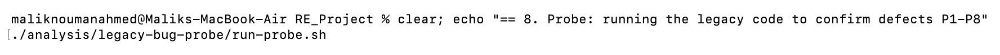

![[landscape] Step 8 result: defects P1 to P8 reproduced on the legacy code (27 November 2026)](screenshots/member-a/step8-defect-probe-result.png)

### 7.1 Traceability from finding to test

| Finding | Refactoring | Test file | Example assertion |
| --- | --- | --- | --- |
| `-1` sentinel (BR-03, BR-13) | A1 | `members/tests/test_member_loyalty.py` | `from_legacy(…, -1)` gives 0 points and first purchase |
| Legacy checkout point flow | A1 | same | 150 − 13 + 7 = 144 |
| L-04, probe P3 | A2 | `inventory/tests/test_category_validation.py` | `add_category("bks")` then `get_category("bks").code == "BKS"` |
| BR-02 legacy messages | A2 | same | duplicate gives "Category CLO already existed. Please input again" |
| BR-03 legacy messages | A2 | `members/tests/test_member_validation.py` | blank ID gives "Member ID field is blank. Please input again" |
| L-08 receipt mismatch | A3 | `core/tests/test_money.py` | 73.65 − 7.37 = 66.28, and points 7 / redeem 13 unchanged |

Tests take their expected values from the legacy sample data and the legacy error messages. The deviations D-A2a, D-A2b and D-A3 each have their own named test.

## 8. Handoff and Appendix

Members B and C start from the findings above and a running Django skeleton. Their refactorings are assigned by layer so the three sets do not overlap.

| Member | Layer | Refactorings | Starts from |
| --- | --- | --- | --- |
| A | Domain model | A1 `-1` sentinel, A2 self-validating entities, A3 Money (done) | – |
| B | Data access | B1 Extract Repository, B2 explicit row mapping instead of `toString()`, B3 validated import instead of swallowed errors | INV-1/2/5, P1, P4, P5, data dictionary 3.7, `Member.from_legacy` |
| C | Service + presentation | C1 table models out of business classes (MVC, signals), C2 checkout and loyalty service, C3 discount rules as strategies | L-11, L-12, L-13, BR-07 to BR-15, `Money` |

The full smell list (S-01 to S-13), data smells (DS-1 to DS-10) and regression cases are in `docs/05-team-handoff.md`.

### 8.1 Repository layout

| Folder | Contents |
| --- | --- |
| `legacy-pos/` | Legacy system, unmodified (tag `legacy-baseline`) |
| `reengineered/` | Django project: `pos` settings, apps `core`, `members`, `inventory` |
| `docs/` | Report sources 01–05 |
| `analysis/legacy-bug-probe/` | Probe source, script and output |

### 8.2 Member A commits

| Commit | Content |
| --- | --- |
| `cd9c5ba` | Legacy baseline imported |
| `e8ea53f` | Defect probe P1–P8 |
| `2b9c648` | Phase 1 inventory |
| `abdb1bf` | Phase 2 legacy documentation |
| `6c5a734` | Risk register |
| `40fb73a` | Refactoring plan A1–A3 |
| `d9a818d` | Handoff to B and C |
| `4093551` | Django skeleton |
| `d7579b1` | Refactoring A1 |
| `4dda7ef` | Refactoring A2 |
| `31f0468` | Refactoring A3 |
| `f266079` | Documentation synced with code |

### 8.3 How to run

```bash
# reengineered system (Python 3.12 or 3.13)
cd reengineered
python3.12 -m venv .venv && source .venv/bin/activate
pip install -r requirements.txt
python manage.py migrate
python manage.py test            # 44 tests

# legacy defect probes (JDK 11+)
./analysis/legacy-bug-probe/run-probe.sh
```
